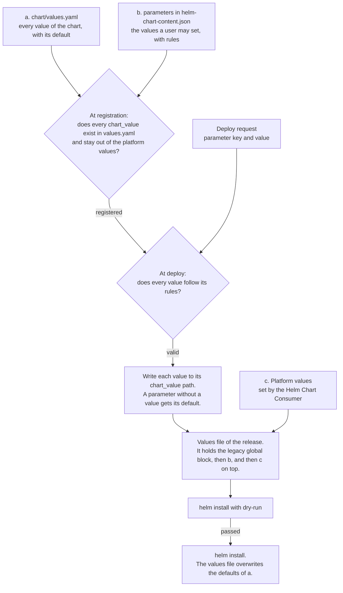

# Helm Chart Consumer: decisions for the MVP

This document records the decisions for the MVP of the Helm Chart Consumer. The decisions build on four sources:

- [concept.md](concept.md) holds the epics and user stories. This document cites them as "Story 2.2".
- [QandA.md](QandA.md) holds the answers of the team. This document cites them as "Q6".
- [handoff.md](handoff.md) holds the facts about the existing code, and what the decisions mean for an implementation.
- [api-mock/](api-mock/) proposes the routes and models.

A statement marked *(proposed)* is not confirmed by the team yet. A heading marked *(proposed)* marks its whole section. A statement marked *(to be decided)* describes something that the implementation still has to work out, so it can change. The section [Open questions](#open-questions) lists what blocks a decision.

## Scope

The MVP lets a principal investigator deploy an application in a project, and lets the members of the project use it:

- The Extension Manager registers the helm-chart content of an extension as a version of an application.
- A kaapana-system-admin enables the application in projects.
- A principal investigator deploys the application in a project and sets its parameters. The result is a release.
- The members of the project see the state of the release and open its web interface.
- A principal investigator undeploys the release, which deletes its volumes.
- An application that is multi-deployable can have several releases in one project.

The Helm Chart Consumer runs next to kube-helm and does not replace it. kube-helm keeps these tasks:

| Task of kube-helm | Caller |
|---|---|
| It installs the chart `project-namespace` for every project. | AII |
| It pulls images with the chart `pull-docker-chart`. | base-installer |
| It installs the `preinstall_extensions` at platform deploy. | An init job of kube-helm |
| It serves the applications that workflows start, with `/complete-active-application`, `/active-applications` and `/pending-applications-count`. | Workflows |
| It keeps the releases that were installed from the legacy page. | kaapana-system-admin |

See [An older helm deployer exists][h-kube-helm].

## Words of the ticket and words of the concept

The ticket uses "install" for two different steps. The concept separates them, because installing an extension only makes an application available, and deploying it is a later step by another user. The [glossary][glossary] defines all terms.

| The ticket says | The concept says | Stories |
|---|---|---|
| Install or uninstall a content | Register or deregister a version of a helm-chart content. The Extension Manager triggers it. | [1.1][s1.1], [1.2][s1.2] |
| Install a chart with values | Deploy an application. The result is a release. | [2.1][s2.1], [2.2][s2.2] |
| Uninstall | Undeploy a release | [2.3][s2.3] |
| A copy | A release | [8.1][s8.1] |
| Starting, running, failed with a reason | The states `deploying`, `ready` and `failed`, with `state_reason` | [3.1][s3.1] |

## Interface of the service

The routes are in [api-mock/app/routers/][routers], and the models are in [api-mock/app/models.py][models]. Every route has a docstring that says what it does. This section groups the routes by caller.

### Extension Manager

| Route | What it does |
|---|---|
| `PUT /v1/applications/{id}/versions/{version}` | Registers a version. The consumer validates `helm-chart-content.json` and runs `helm lint` on the chart. It answers 201 for a new version, 200 if the same content is already registered under this version, and 409 if another content is. See [Versioning](#versioning). |
| `DELETE /v1/applications/{id}/versions/{version}` | Deregisters a version. Its releases keep running. |
| `GET /v1/applications/{id}/versions/{version}` | Returns the status of a content: registered, or deregistered while releases still run it. |

There is no update route. Updating an extension registers the new version and deregisters the old one ([Story 1.3][s1.3]). If the content did not change, both are the same version, and nothing is deregistered. The Extension Manager calls consumers from Python plugins, which sets rules for the `Location` header, for retries and for the failure reason. See [The Extension Manager calls consumers as Python plugins][h-em].

### Application page

| Route | What it does |
|---|---|
| `GET /v1/applications?project_id=` | Lists the applications that can be deployed in the project ([Story 5.8][s5.8]) |
| `GET /v1/applications/{id}/versions/{version}` | Returns the parameter declarations that the deploy form is built from |
| `POST /v1/releases/dry-run` | Runs every check of a deploy and a helm dry-run. Returns all problems and the chart values. |
| `POST /v1/releases` | Deploys. The new release starts in the state `deploying`. |
| `GET /v1/releases`, `GET /v1/releases/{id}` | Lists releases, and returns one release with its state and its reason |
| `DELETE /v1/releases/{id}` | Undeploys, and deletes the volumes with their data ([Q5][q5]) |

A deploy shares one sequence of checks with its dry-run. See [Share one check sequence between dry-run and the real call][h-checks]. The state is derived from the helm release and its objects. See [Derive the state, do not store it][h-state].

### kaapana-system-admin

| Route | What it does |
|---|---|
| `GET /v1/applications` | Lists all applications that have a registered version ([Story 5.7][s5.7]) |
| `GET /v1/applications?project_id=` | Lists the applications that are enabled in a project ([Story 5.8][s5.8]) |
| `GET /v1/applications/{id}/versions` | Lists the versions of an application. With `include_deregistered=true`, it also lists versions that releases still run after their extension was uninstalled ([Story 1.2][s1.2]). |
| `PUT`, `DELETE /v1/projects/{id}/enabled-applications/{application_id}` | Enables and disables an application in a project ([Story 5.2][s5.2]). Both answer without a body. |

An enablement is only the pair of a project and an application. The consumer does not record who enabled an application or when, so there is no route that lists enablements. Every application in the list names the projects in which it is enabled, as `enabled_project_ids` ([Story 5.7][s5.7]). The consumer knows the projects of the caller and the rights in them from the access token, so it filters the list and this field without a request per project. An admin gets all applications and all projects. A principal investigator gets the applications that are enabled in the projects in which they may deploy ([Story 5.8][s5.8]). A scientist cannot deploy and gets none. The kaapana-system-admin also uses every route of the application page, in every project ([Story 5.1][s5.1]).

### Access-information-interface (AII)

- Before AII deletes a project, it asks `GET /v1/releases?project_id=<id>` and refuses the deletion while releases exist ([Q9][q9], [Story 12.2][s12.2]). See [Let project management ask before deleting a project][h-project-deletion].

## Content of a helm-chart content

An extension brings a helm-chart content as one directory. See [Extension source code with content helm-chart][c-layout] and [Story 4.1][s4.1].

```
extension_manifest.json        declares the content and its contentType
helm-chart-content/
    helm-chart-content.json    what Kaapana reads
    chart/                     a plain helm chart
```

`helm-chart-content.json` follows the model `HelmChartContent` in [api-mock/app/models.py][models]. `GET /v1/helm-chart-content-schema` returns its JSON schema ([Story 4.2][s4.2]). Unknown fields are rejected.

| Field | Meaning |
|---|---|
| `name` | The id of the application. It appears in URLs. |
| `version` | The version of the content, as a semantic version. It is independent of the version of the extension. See [Versioning](#versioning). |
| `display_name`, `description` | What users see |
| `multi_deployable` | Whether the application can have several releases in the same project. The default is `false`. |
| `parameters` | The values a user may set. See [Configuration of parameters](#configuration-of-parameters). |

The `contentType` of a helm-chart content is `helm-chart-v1` *(proposed)*. The name follows the pattern of `workflow-v1`, the type of a workflow content. The Extension Manager reads the `contentType` in `extension_manifest.json` to pick the consumer of a content. The suffix versions the format of the content, so a later format can get its own type.

### The web interface of a release

`helm-chart-content.json` does not declare a web interface. The chart creates the route to its web interface itself, as an `Ingress`, and the consumer discovers it there ([Story 4.4][s4.4]). This works in the way the portal discovers the entries of its menu.

- **The annotation.** The chart marks the `Ingress` of its web interface with an annotation. The legacy system uses `kaapana.ai/type: application` for this, and kube-helm lists every such `Ingress` as an active application ([routes.py][kh-routes]). Whether the new system keeps this name is still to be decided.
- **Discovery.** The consumer reads the `Ingress` objects in the manifest of the helm release. The path of the marked one becomes the `url` of the release. An annotation can name an entry path below it, such as `/lab` for JupyterLab, as `kaapana.ai/ui.path` does for the menu.
- **Where the link appears.** The application page shows the link in its list of releases ([Story 2.4][s2.4]). The link does not appear in the menu of the platform. A chart that also wants a menu entry adds the annotations of the portal to its `Ingress` ([menu.py][portal-menu]).
- **The path.** The chart serves under the platform value `url_path`, so that the rules of the gateway match the route.

## Configuration of parameters

### Three sources of chart values

| Source | Who writes it | What it holds |
|---|---|---|
| a. `chart/values.yaml` | Extension developer | Every value that the chart accepts, with its default. It is the source of truth for what can be configured. |
| b. `parameters` in `helm-chart-content.json` | Extension developer | The values that a user may set. Each parameter has a type, rules, a label, and the path of its chart value (`chart_value`). |
| c. Platform values | Helm Chart Consumer | The values that Kaapana sets on every deploy. A user can never set them. The consumer passes the legacy `global` block in addition. See [The legacy `global` block](#the-legacy-global-block). |

Source b is the model `ParameterDeclaration` in [api-mock/app/models.py][models]. It supports the types string, integer, boolean and choice, with the rules `pattern`, `minimum`, `maximum`, `choices` and `required` ([Story 2.2][s2.2]).

### Rules

- A user can only set a value that source b declares. Every other chart value keeps the default from `values.yaml` ([Story 2.2][s2.2]).
- The values of a request are validated against the declarations before anything is deployed. Then the helm dry-run finds errors in the rendered chart ([Story 2.1][s2.1]).
- A secret parameter is configured like every other parameter, and its value is set as a chart value. The consumer masks the value in its responses ([Story 3.2][s3.2]). See [Never return a secret, and keep it out of the helm values][h-secrets].
- **Check at registration** *(proposed)*. Every `chart_value` must be a path that exists in `values.yaml`, and no `chart_value` may point into the platform values. Without this check, a typing error in a path is accepted and the parameter silently has no effect.
- **One place for a default** *(proposed)*. `default` in a declaration is optional. If it is missing, the consumer reads the default from `values.yaml` at registration and stores it with the version. If both exist, the declaration wins, and the form shows that value. This way the two defaults cannot differ without anyone noticing.
- **Order** *(proposed)*. Later sources overwrite earlier ones: first `values.yaml`, then the legacy `global` block, then the parameter values, then the platform values.
- **A values file, not `--set`** *(proposed)*. The consumer writes the values of a release into one file and passes it with `-f`. kube-helm builds `--set-string` arguments and removes spaces and escapes commas to do so ([utils.py][kh-utils]), which changes values and loses their types.

An example with a default that comes from `values.yaml`:

```yaml
# chart/values.yaml
resources:
  memoryGib: 4
```

```json
{
  "key": "memory_gib",
  "label": "Memory in GiB",
  "type": "integer",
  "minimum": 1,
  "maximum": 64,
  "chart_value": "resources.memoryGib"
}
```

The form shows 4. A request with `"memory_gib": 16` sets `resources.memoryGib` to 16, and a request with 128 is rejected.

### Values that the Helm Chart Consumer sets *(proposed)*

[Pass the same platform values to every chart][h-platform-values] decides that the platform owns a set of values. This section proposes where they live and what they are.

All platform values are under the one reserved key `global.kaapana`. One key needs only one check at registration, and helm passes `global` on to subcharts, so a wrapped public chart sees the values too.

| Value | Meaning | Source |
|---|---|---|
| `release.id`, `release.name` | The id of the release and the name that users see | [Story 8.3][s8.3] |
| `application.id`, `application.version` | The registered version that the release runs | [Story 11.1][s11.1] |
| `project.id`, `project.short_id`, `project.namespace`, `project.bucket` | The project of the release | [Story 2.5][s2.5], [Q6][q6] |
| `url_path` | The path under which the web interface is served, for settings like `base_url` of JupyterLab | [Story 4.4][s4.4] |
| `hostname` | The host name of the platform | [Story 4.4][s4.4] |
| `registry_url`, `pull_policy`, `image_pull_secret` | Where and how the images of Kaapana charts are pulled | Legacy `global.registry_url` and `global.pull_policy_images` |
| `namespaces.services`, `namespaces.admin` | The namespaces of the platform services | Legacy `global.services_namespace` and `global.admin_namespace` |
| `build_version`, `platform_prefix`, `internal_cidrs` | The version of the platform, the prefix of its namespaces, and the address ranges inside the cluster | Legacy `global.kaapana_build_version`, `global.platform_prefix` and `global.internalCidrs` |

The helm release name is not in the table, because helm gives it to every chart as `.Release.Name`. See [Copies of an application](#copies-of-an-application).

The list is fixed and documented for extension developers. A new chart reads only these values.

#### The legacy `global` block

The consumer also passes the values that kube-helm passes to a chart today, under their old names. A legacy chart therefore needs no change to its templates.

| Value | Meaning |
|---|---|
| `global.*` of the platform release | Every value of the `global` block of the platform release, for example `global.registry_url`, `global.services_namespace` and `global.credentials_minio_password`. kube-helm reads the block from the helm release of the platform ([utils.py][kh-utils]), and the consumer does the same. |
| `global.project_id`, `global.project_name`, `global.project_short_id`, `global.project_namespace` | The project of the release. kube-helm reads them from AII and adds them ([routes.py][kh-routes]). |

- **The block contains passwords.** [kaapanactl.sh][kaapanactl] writes them into it, for example `global.credentials_keycloak_admin_password` and `global.credentials_minio_password`. Every release can read them. See [Credentials of an application](#credentials-of-an-application).
- **The block is deprecated.** A new chart reads the values under `global.kaapana` and not the block. It is planned to stop passing the block, so that a chart gets no `global` value outside `global.kaapana`.
- **A parameter can overwrite a value of the block**, as a value of the install form can with kube-helm today.

### How the chart values of a release are built



## Copies of an application

The legacy system marks a chart with the keyword `kaapanamultiinstallable`. kube-helm then installs every copy under the helm release name `<chart>-<random suffix>`, and the `multiinstallable_whitelist` of a project in AII limits which of these charts its members may launch.

In the new system, `multi_deployable: true` in `helm-chart-content.json` replaces the keyword ([Story 8.1][s8.1]). Every copy is a release.

### Two records, two ids

| Record | Created when | Identified by | Example |
|---|---|---|---|
| Registered version of a helm-chart content | The extension is installed | Application id and version | `jupyterlab`, `4.3.0` |
| Release | Someone deploys | Release id | `3f2a9c1e-6b4d-4e8a-9c57-1d0f8a2b7e31`, with the name `anna-notebook` |

One registered version can have many releases. The release id is the key of the record, a UUID that the consumer generates. `POST /v1/releases` returns it as `Release.id`, and every route of a single release takes it in the path. See [Model an application as its registered versions][h-versions] and [Keep a record of every release][h-records].

### Names and conflicts

- Extension developers are responsible that the objects of their chart do not collide ([Story 4.3][s4.3]).
- **The helm release name keeps copies apart** *(proposed)*. The id of the helm-chart content cannot do this, because it is the same for all copies. The consumer generates the helm release name from the application id and the first characters of the release id, for example `jupyterlab-3f2a9c1e`, and checks that no other release has it. It is unique in the whole cluster, starts with a letter, and stays below the 53 characters that helm allows. The consumer stores it with the release.
- A chart that names its objects after `.Release.Name` is safe to deploy several times without a Kaapana value. Most public charts do this already.
- The name that a user types, such as `anna-notebook`, is what the UI shows, and it is part of the URL ([Story 8.3][s8.3]). It is unique only within a project, so it cannot be the helm release name unless every project gets its own namespace ([Q6][q6]).

### Listing and uninstalling

- **Limits.** An application that is not multi-deployable has at most one release per project, counted over all its versions. A multi-deployable application can have several releases in a project ([Story 8.1][s8.1]).
- **Listing.** `GET /v1/releases?application_id=<id>&project_id=<id>` lists the copies ([Story 8.3][s8.3]).
- **A new version.** Registering a new version changes no running copy.
- **Uninstalling the extension.** The version is deregistered and can no longer be deployed, unless another installed extension brings the same version. Its copies keep running, are marked with `version_registered: false`, and can still be opened and undeployed ([Story 1.2][s1.2], [Q4][q4]). See [Keep the chart and the declarations of every release][h-keep-chart].
- **Undeploy.** Every copy is undeployed on its own with `DELETE /v1/releases/{id}`. This deletes its volumes ([Q5][q5]).
- **Enablement replaces the whitelist** *(proposed)*. Both say which applications a project may use, so two mechanisms would have to be kept in sync. See [An older helm deployer exists][h-kube-helm].

## Versioning

Three different things have a version:

| Version | Example | What it versions |
|---|---|---|
| API version | `/v1` | The routes and models of the Helm Chart Consumer |
| Content type | `helm-chart-v1` | The schema of `helm-chart-content.json` and the layout of the content |
| Content version | `4.3.0` | One helm-chart content. `helm-chart-content.json` declares it in `version` *(proposed)*. The consumer does not look at the version of the extension, so the two can be equal or differ ([Story 11.1][s11.1]). |

Rules for the content version:

- Several versions of one helm-chart content can be registered at the same time ([Q3][q3]). A registered version is keyed by application id and version.
- A registered version never changes. Registering the same content again changes nothing, and a different content for the same name and version answers 409.
- **The version is declared in the content** *(proposed)*. `helm-chart-content.json` has the required field `version`. The consumer does not look at the version of the extension, so a content can carry the same version as its extension or another one. Which version a content gets is the responsibility of the extension developer. A changed chart or a changed `helm-chart-content.json` needs a new version, because a registered version never changes.
- **The answer tells whether the version is new** *(proposed)*. A registration answers 201 if the version was not registered, and 200 if the same content was already registered under this version. Both return the same `Location`.
- **The consumer compares contents by a digest** *(proposed)*. At registration, it computes a digest over `helm-chart-content.json` and every file of the chart, and stores it with the version. A later registration of this version has the same content if its digest is equal. Where the chart was fetched from is not part of the digest. The digest is computed over the files and not over the packaged chart, because two packages of the same chart differ in their timestamps.
- **Several extensions can bring the same version** *(proposed)*. The consumer does not record which extension registered a version. The Extension Manager could keep this record. It already stores the `Location` of every content that it installs, so it could deregister a version only when no other installed content has the same `Location`. It does not do this today. See [Open questions](#open-questions).
- A release runs exactly one version. Registering another version does not change it.
- A deregistered version stays readable while releases run it ([Q4][q4]).
- Whether a new version of an enabled application starts enabled is open ([Q12][q12]).
- **Versions are semantic versions** *(proposed)*. The consumer rejects any other version at registration. The API needs an order for "newest", and helm requires semantic versions for charts too. The current build version `0.7.0-latest` is a valid semantic version.
- **The consumer ignores `version` and `appVersion` in `Chart.yaml`** *(proposed)*. The build tooling can set them to the content version, so that `helm list` shows the same number.

## Labels on Kubernetes objects *(proposed)*

Helm adds the label `app.kubernetes.io/managed-by: Helm` and the annotations `meta.helm.sh/release-name` and `meta.helm.sh/release-namespace` to every object that it creates. It adds nothing else, and the consumer cannot add labels to objects without rewriting the rendered chart. The consumer therefore does not depend on object labels:

- Readiness and pods come from the manifest and from owner references. See [Derive the state, do not store it][h-state].
- The volume claims of a StatefulSet survive `helm uninstall`. Their names follow from the StatefulSet in the manifest, as `<claim template>-<StatefulSet>-<ordinal>`. See [Undeploying deletes the data, and helm does not do that alone][h-undeploy].
- A pod that needs a route through the network policies of its project sets the label itself, for example `network-access-opensearch`. See [Every project already has a namespace][h-namespace]. The labels that are allowed are documented for extension developers.

## Authorization

> **To do:** paste Lorenz's sketch here.

A request of a user reaches the consumer through the gateway. The gateway checks the login and passes the Keycloak token of the user on, in the header `X-Forwarded-Access-Token` ([configmap.yaml][oauth2-proxy]). The consumer decides from this token whether the caller may do what the request asks.

**What the token carries.** Keycloak asks AII for the projects and rights of the user when it issues the token ([kaapana-client.json][kc-client]). A changed role therefore takes effect with the next token.

| Claim | Content | Example |
|---|---|---|
| `projects` | Every project of the user, with the role of the user in it | `{"id": "<project id>", "name": "lung-ct", "role_name": "principal-investigator"}` |
| `realm_access.roles` | The roles for the whole platform. The role `admin` is the kaapana-system-admin. | `["user", "admin"]` |
| `kaapana.ai/applications` | The rights of the user for applications, one entry per right and project | `["open_<project id>", "launch_<project id>"]` |

How the consumer checks a call is to be decided. Two options exist.

### Option 1: check by role *(to be decided)*

This is the simple option. The consumer checks a call in three steps:

1. It verifies the signature of the token with the public key of Keycloak, and it checks the issuer, the audience and the expiry. After that, it can rely on the claims. dicom-web-filter verifies its tokens in this way ([auth_middleware.py][dwf-auth]). The gateway has checked the login already, but a call from inside the cluster does not pass the gateway.
2. It reads the role of the caller. `admin` in `realm_access.roles` is a kaapana-system-admin. Otherwise, the entry of the project in `projects` names the role: `scientist` or `principal-investigator`. A caller without an entry for the project is refused.
3. It looks up the action and the role in one table, which holds every permission rule ([Story 5.1][s5.1]):

| Action | Scientist of the project | PI of the project | kaapana-system-admin |
|---|---|---|---|
| List the releases of the project, see their state, open their web interface | yes | yes | yes |
| Deploy and undeploy in the project | no | yes | yes |
| See the applications that are enabled in one of their projects | no | yes | yes |
| Enable and disable applications | no | no | yes |
| See all applications and where they are enabled | no | no | yes |

The names of the roles are then fixed in the consumer.

### Option 2: check by right *(to be decided)*

The consumer verifies the token as in Option 1. It then checks the rights in the token, such as `launch_<project id>` in `kaapana.ai/applications`, and not the name of the role. The rules of the gateway work in this way. A role with another name then needs no change in the consumer. Which right each action needs would have to be defined.

### Callers inside the cluster *(open)*

What is open: how callers inside the cluster prove who they are. The Extension Manager and AII call from pod to pod, without a user. A network policy can limit who reaches the consumer from inside the cluster *(proposed)*. See [Open questions](#open-questions).

### The origin of a release

Every release records who deployed it, as `origin`. See `UserOrigin` in [api-mock/app/models.py][models].

- The consumer sets `user_id` to the calling user, whom it knows from the gateway. A user origin that names another user is rejected, so nobody can deploy in the name of someone else.
- The origin describes only the creation of a release.

### Credentials of an application

A release gets the passwords of the platform through the legacy `global` block. See [The legacy `global` block](#the-legacy-global-block). The charts of JupyterLab and MITK Workbench, for example, take the login of the root user of MinIO from it to sync a folder with the bucket of the project.

- **An application can therefore reach more than its project.** With the login of MinIO it reaches the buckets of all projects, and only the path that its chart sets keeps it in the bucket of its project. The block also holds the admin password of Keycloak, the login of the registry and the client secret of Keycloak.
- **kube-helm passes the same block to every chart today.** The consumer changes nothing here.
- **It is planned to change this.** An application then gets credentials that are limited to its project, and no password of the platform.

### Who can open a release

Every member of a project can open every release of the project ([Q1][q1], [Story 5.3][s5.3]). "Deployed for" does not restrict access on purpose.

## Using a chart from a public registry *(proposed)*

The goal is that a public chart needs no change. The extension wraps it:

1. `chart/Chart.yaml` lists the public chart under `dependencies`. The build runs `helm dependency build`, so the packaged extension contains the public chart, and the consumer needs no access to the public registry.
2. `chart/values.yaml` sets the values of the public chart under the name of the dependency. The `chart_value` of a parameter starts with that name, for example `jupyterhub.singleuser.memory.limit`.
3. `helm-chart-content.json` declares the name, the description and the parameters.

### The web interface of a wrapped chart

The route to the web interface comes from the chart, as for every helm-chart content.

- **The wrapper brings the `Ingress`.** A template of the wrapper can read the platform values, so its `Ingress` serves under `global.kaapana.url_path` and carries the annotation of the web interface.
- **A platform value cannot reach a value of the public chart.** Helm does not render `values.yaml`, so a wrapper cannot hand `global.kaapana.url_path` to a value of the public chart. A public chart can therefore be wrapped without changes only if its own values need no platform value.

## Converting a legacy chart

| Legacy | New |
|---|---|
| Keyword `kaapanamultiinstallable` | `multi_deployable: true` |
| `extension_params.<key>` in `values.yaml`, written to `global.<key>` | A parameter with `chart_value: global.<key>` |
| Types `string`, `bool`, `list_single` | Types `string`, `boolean`, `choice` |
| Type `doc` | `description` |
| `global.*` copied from the platform release | Unchanged. The consumer passes the same values. See [The legacy `global` block](#the-legacy-global-block). |
| Ingress with the annotation `kaapana.ai/type: application` | The chart keeps its `Ingress`. See [The web interface of a release](#the-web-interface-of-a-release). |

A legacy chart keeps reading platform values by their old names, for example `global.registry_url`, so its templates need no change. A new chart reads the values under `global.kaapana`.

## Open questions

[handoff.md][h-open] lists all open questions. These block decisions in this document:

| Question | What depends on it |
|---|---|
| [Q6][q6]: Do applications run in one namespace per project, in one namespace per release, or in a shared namespace? | Two things. First, which objects can collide. The name of a Kubernetes object must be unique in its namespace, so the answer decides what a chart has to do so that its objects do not collide with those of another release ([Story 4.3][s4.3]). Second, whether the name that a user types, such as `anna-notebook`, can also be the helm release name. This name is unique only within a project, so it works only if every project has its own namespace. |
| [Q12][q12]: An application is enabled per project. When a new version of an enabled application is registered, can it be deployed at once, or does an admin have to enable it first? | Whether an enablement belongs to an application or to one of its versions. |
| [Q14][q14]: Several extensions can bring versions of the same helm-chart content. Is a content identified by its name alone, or by the name of its extension together with its name? | The id of an application in the routes, such as `/v1/applications/{id}`, and what happens when two extensions register the same name and version. The rules in [Versioning](#versioning) assume the name alone. |
| Does the Extension Manager deregister a version only when no other installed extension brings it? | Whether several extensions can bring the same version of a content. Without it, uninstalling one extension deregisters a version that another extension still needs. See [Versioning](#versioning). |
| The Extension Manager and AII call the consumer from pod to pod, without a user and without the gateway. How does the consumer know that such a call really comes from them? | Who can register a chart and list the releases of a project. Without an answer, every pod that reaches the consumer can do both. A network policy is proposed. See [Authorization](#authorization). |
| Helm creates the objects of a chart with the rights of the service account of the consumer. Which rights does this account get? | What a chart can create. With rights on the whole cluster, a chart can create objects in other namespaces, including roles that read the secrets there. |
| How do the files of a chart reach the consumer at registration? | The request of the registration route `PUT /v1/applications/{id}/versions/{version}`. |
| Is the consumer a part of `kaapana-admin-chart`, which `kaapanactl.sh` installs, or of `kaapana-platform-chart`, which is installed after it? | When the consumer is available during the platform deploy, and in which namespace it runs. |

[glossary]: concept.md#glossary
[c-layout]: concept.md#extension-source-code-with-content-helm-chart
[s1.1]: concept.md#story-11-registering-a-helm-chart-content-when-its-extension-is-installed
[s1.2]: concept.md#story-12-deregistering-a-helm-chart-content-when-its-extension-is-uninstalled
[s1.3]: concept.md#story-13-replacing-a-helm-chart-content-version-when-its-extension-is-updated
[s2.1]: concept.md#story-21-deploying-an-application
[s2.2]: concept.md#story-22-configuring-an-application-at-deploy
[s2.3]: concept.md#story-23-undeploying-an-application
[s2.4]: concept.md#story-24-opening-an-application
[s2.5]: concept.md#story-25-working-on-existing-data
[s3.1]: concept.md#story-31-seeing-the-status-of-a-deployed-application
[s3.2]: concept.md#story-32-seeing-the-configuration-of-a-deployed-application
[s4.1]: concept.md#story-41-packaging-a-helm-chart-as-an-extension
[s4.2]: concept.md#story-42-declaring-how-kaapana-presents-and-deploys-an-application
[s4.3]: concept.md#story-43-avoiding-conflicts-with-existing-kubernetes-resources
[s4.4]: concept.md#story-44-exposing-the-web-interface-of-an-application
[s5.1]: concept.md#story-51-default-permissions
[s5.2]: concept.md#story-52-enabling-applications-for-a-project
[s5.3]: concept.md#story-53-restricting-who-can-open-an-application
[s5.7]: concept.md#story-57-seeing-where-applications-are-enabled
[s5.8]: concept.md#story-58-seeing-the-applications-that-are-enabled-in-a-project
[s8.1]: concept.md#story-81-deploying-an-application-multiple-times
[s8.3]: concept.md#story-83-identifying-deployed-applications
[s11.1]: concept.md#story-111-browsing-available-versions
[s12.2]: concept.md#story-122-deleting-a-project-with-deployed-applications
[q1]: QandA.md#q1-ownership
[q3]: QandA.md#q3-parallel-versions
[q4]: QandA.md#q4-deregistered-content
[q5]: QandA.md#q5-persistent-volumes-on-undeploy
[q6]: QandA.md#q6-namespaces
[q9]: QandA.md#q9-project-deletion
[q12]: QandA.md#q12-enabling-new-versions
[q14]: QandA.md#q14-identity-of-a-helm-chart-content
[h-em]: handoff.md#the-extension-manager-calls-consumers-as-python-plugins
[h-kube-helm]: handoff.md#an-older-helm-deployer-exists
[h-namespace]: handoff.md#every-project-already-has-a-namespace
[h-versions]: handoff.md#model-an-application-as-its-registered-versions
[h-records]: handoff.md#keep-a-record-of-every-release
[h-keep-chart]: handoff.md#keep-the-chart-and-the-declarations-of-every-release
[h-state]: handoff.md#derive-the-state-do-not-store-it
[h-checks]: handoff.md#share-one-check-sequence-between-dry-run-and-the-real-call
[h-secrets]: handoff.md#never-return-a-secret-and-keep-it-out-of-the-helm-values
[h-undeploy]: handoff.md#undeploying-deletes-the-data-and-helm-does-not-do-that-alone
[h-platform-values]: handoff.md#pass-the-same-platform-values-to-every-chart
[h-project-deletion]: handoff.md#let-project-management-ask-before-deleting-a-project
[h-open]: handoff.md#open-questions
[routers]: api-mock/app/routers/
[models]: api-mock/app/models.py
[kc-client]: ../../kaapana-admin/keycloak/keycloak-setup/keycloak-setup-chart/realm_objects/kaapana-client.json
[dwf-auth]: ../../data-separation/dicom-web-filter/docker/files/app/auth_middleware.py
[oauth2-proxy]: ../../kaapana-admin/oAuth2-proxy/oAuth2-proxy-chart/templates/configmap.yaml
[kh-routes]: ../../kaapana-admin/kube-helm/docker/files/backend/app/routes.py
[kh-utils]: ../../kaapana-admin/kube-helm/docker/files/backend/app/utils.py
[portal-menu]: ../portal-api/docker/app/menu.py
[kaapanactl]: ../../../kaapanactl.sh
