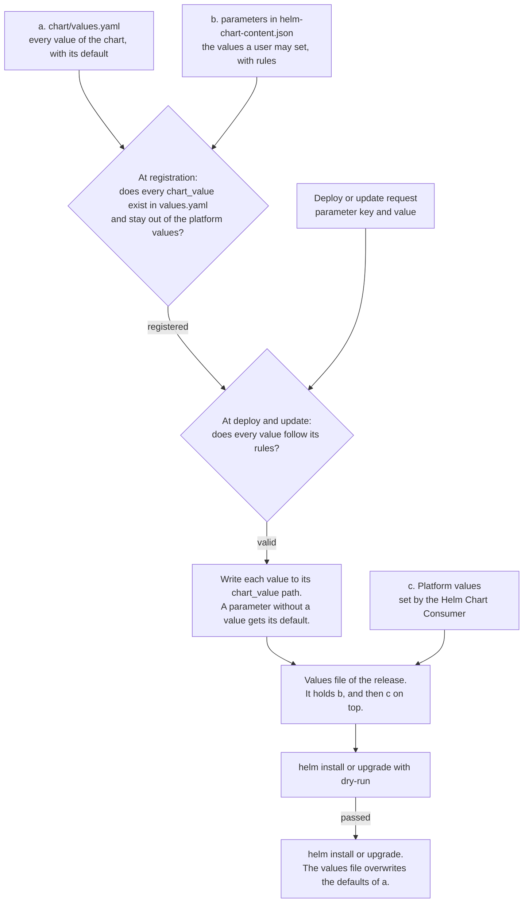

# Helm Chart Consumer: decisions and answers to the acceptance criteria

This document records the decisions for the Helm Chart Consumer. It then answers the acceptance criteria of the concept ticket with these decisions. The decisions build on four sources:

- [concept.md](concept.md) holds the epics and user stories. This document cites them as "Story 2.2".
- [QandA.md](QandA.md) holds the answers of the team. This document cites them as "Q6".
- [handoff.md](handoff.md) holds the facts about the existing code, and what the decisions mean for an implementation.
- [api-mock/](api-mock/) proposes the routes and models.

A statement marked *(proposed)* is not confirmed by the team yet. A heading marked *(proposed)* marks its whole section. A statement marked *(to be decided)* describes something that the implementation still has to work out, so it can change. The section [Open questions](#open-questions) lists what blocks a decision. The last section, [Acceptance criteria (ticket)](#acceptance-criteria-ticket), quotes the ticket and links each question to its answer.

## Words of the ticket and words of the concept

The ticket uses "install" for two different steps. The concept separates them, because installing an extension only makes an application available, and deploying it is a later step by another user. The [glossary][glossary] defines all terms.

| The ticket says | The concept says | Stories |
|---|---|---|
| Install or uninstall a content | Register or deregister a version of a helm-chart content. The Extension Manager triggers it. | [1.1][s1.1], [1.2][s1.2] |
| Install a chart with values | Deploy an application. The result is a release. | [2.1][s2.1], [2.2][s2.2] |
| Update | Update a release: its version, its parameters, or both | [11.2][s11.2], [11.3][s11.3], [11.4][s11.4] |
| Uninstall | Undeploy a release | [2.3][s2.3] |
| A copy | A release | [8.1][s8.1] |
| Starting, running, failed with a reason | The states `deploying`, `ready` and `failed`, with `state_reason` | [3.1][s3.1] |

## Interface of the service

The routes are in [api-mock/app/routers/][routers], and the models are in [api-mock/app/models.py][models]. Every route has a docstring that says what it does. This section groups the routes by caller.

### Extension Manager

| Route | What it does |
|---|---|
| `PUT /v1/applications/{id}/versions/{version}` | Registers a version. The consumer validates `helm-chart-content.json` and runs `helm lint` on the chart. The same request twice changes nothing. A different content for the same version answers 409. |
| `DELETE /v1/applications/{id}/versions/{version}` | Deregisters a version. Its releases keep running. |
| `GET /v1/applications/{id}/versions/{version}` | Returns the status of a content: registered, or deregistered while releases still run it. |

There is no update route. Updating an extension registers the new version and deregisters the old one ([Story 1.3][s1.3]). The Extension Manager calls consumers from Python plugins, which sets rules for the `Location` header, for retries and for the failure reason. See [The Extension Manager calls consumers as Python plugins][h-em].

The platform registers its own contents with the same routes, without an extension. See [Charts that other services install](#charts-that-other-services-install-proposed).

### Application page

| Route | What it does |
|---|---|
| `GET /v1/applications?project_id=` | Lists the applications that can be deployed in the project |
| `GET /v1/applications/{id}/versions/{version}` | Returns the parameter declarations that the deploy form is built from |
| `POST /v1/releases/dry-run` | Runs every check of a deploy and a helm dry-run. Returns all problems and the chart values. |
| `POST /v1/releases` | Deploys. The new release starts in the state `deploying`. |
| `GET /v1/releases`, `GET /v1/releases/{id}` | Lists releases, and returns one release with its state and its reason |
| `GET /v1/releases/{id}/status` | Returns the Kubernetes objects, pods, events and the helm error *(to be decided)* |
| `POST /v1/releases/{id}/dry-run`, `PATCH /v1/releases/{id}` | Checks and runs an update of the version, the parameters, or both |
| `DELETE /v1/releases/{id}` | Undeploys, and deletes the volumes with their data ([Q5][q5]) |

At this point it's unclear how and to what extent the `GET /v1/releases/{id}/status` route should be implemented. Should this actually look into multiple k8s objects and their state, or just print e.g. a health endpoint or the helm release's status?

Deploy and update share one sequence of checks with their dry-run. See [Share one check sequence between dry-run and the real call][h-checks]. The state is derived from the helm release and its objects. See [Derive the state, do not store it][h-state].

### kaapana-system-admin

| Route | What it does |
|---|---|
| `GET /v1/applications` | Lists all applications that have a registered version. With `scope=platform`, it lists those that can be deployed platform-wide. |
| `GET /v1/applications?project_id=` | Lists the applications that are enabled in a project |
| `GET /v1/applications/{id}/versions` | Lists the versions of an application. With `include_deregistered=true`, it also lists versions that releases still run after their extension was uninstalled ([Story 1.2][s1.2]). |
| `PUT`, `DELETE /v1/projects/{id}/enabled-applications/{application_id}` | Enables and disables an application in a project ([Story 5.2][s5.2]). Both answer without a body. |
| `GET /v1/releases` | Lists the releases of all projects ([Story 3.4][s3.4]) |

An enablement is only the pair of a project and an application. The consumer does not record who enabled an application or when, so there is no route that lists enablements. The kaapana-system-admin also uses every route of the application page, in every project and platform-wide ([Story 5.1][s5.1]).

### Access-information-interface (AII)

- Before AII deletes a project, it asks `GET /v1/releases?project_id=<id>` and refuses the deletion while releases exist ([Q9][q9], [Story 12.2][s12.2]). See [Let project management ask before deleting a project][h-project-deletion].
- AII deploys one release of the application `project-namespace` for every project with `POST /v1/releases`, and undeploys it with `DELETE /v1/releases/{id}` when the project is deleted. It finds the release with `GET /v1/releases?application_id=project-namespace&name=project-<short_id>`. See [Charts that other services install](#charts-that-other-services-install-proposed).

### Installer and platform deploy

- The base-installer pulls images. It deploys one release of the application `pull-docker-chart` per image with `POST /v1/releases`. See [Charts that other services install](#charts-that-other-services-install-proposed).
- A job at platform deploy processes the list `preinstall_extensions`. It installs each extension through the Extension Manager, and then deploys the listed releases with `GET /v1/releases?name=<name>` and `POST /v1/releases`. Both routes exist. The same job can register the platform contents. See [Charts at platform deploy and charts from the legacy page](#charts-at-platform-deploy-and-charts-from-the-legacy-page-proposed).
- The chart `kaapana-platform-chart` is in the same list. It is open whether it becomes a platform content or whether `kaapanactl.sh` keeps installing it. See [The three kinds of preinstalled charts](#the-three-kinds-of-preinstalled-charts).

### Workflows

A workflow task deploys with a workflow origin in `POST /v1/releases`, and the user finishes with `POST /v1/releases/{id}/complete`. Both belong to Release 2. See [Interactive workflows are not part of the MVP](#interactive-workflows-are-not-part-of-the-mvp).

## Content of a helm-chart content

An extension brings a helm-chart content as one directory. See [Extension source code with content helm-chart][c-layout] and [Story 4.1][s4.1].

```
extension_manifest.json        declares the content and its contentType
helm-chart-content/
    helm-chart-content.json    what Kaapana reads
    chart/                     a plain helm chart
```

`helm-chart-content.json` follows the model `HelmChartContent` in [api-mock/app/models.py][models]. `GET /v1/helm-chart-content-schema` returns its JSON schema ([Story 4.2][s4.2]). Unknown fields are rejected.

| Field | Meaning |
|---|---|
| `name` | The id of the application. It appears in URLs. |
| `display_name`, `description` | What users see |
| `scopes` | `project`, `platform`, or both. The default is `project` ([Q11][q11]). |
| `multi_deployable` | Whether the application can have several releases in the same scope. A scope is one project or the whole platform. The default is `false`. |
| `web_interface` | The service, the port and the path of the web interface ([Story 4.4][s4.4]) |
| `parameters` | The values a user may set. See [Configuration of parameters](#configuration-of-parameters). |

The `contentType` of a helm-chart content is `helm-chart-v1` *(proposed)*. The name follows the pattern of `workflow-v1`, the type of a workflow content. The Extension Manager reads the `contentType` in `extension_manifest.json` to pick the consumer of a content. The suffix versions the format of the content, so a later format can get its own type.

### Changes to the schema *(proposed)*

A review of the model found these gaps:

- **`name` has no pattern.** The name becomes a URL segment and the start of the helm release name, so it must be a lowercase DNS label with a length limit.
- **`web_interface.service` is a fixed name.** A multi-deployable chart puts the helm release name into the name of its service, so the declaration needs a placeholder for the helm release name.
- **`default` should be optional.** See the rule about defaults in [Rules](#rules).
- **A platform value cannot be mapped onto a chart value.** See [Using a chart from a public registry](#using-a-chart-from-a-public-registry-proposed).
- **The field is called `multi_deployable`.** The [glossary][glossary] also mentions `multiinstallable`. "Install" is reserved for extensions, so `multi_deployable` fits better.
- **There is no field for privileged values.** A platform content declares the passwords that it needs in `platform_secrets`. See [Privileged values for platform contents](#privileged-values-for-platform-contents).
- **A parameter with several choices is not needed.** The legacy type `list_multi` is used by two workflow charts and by no application chart. The legacy type `doc` is help text and becomes `description`.

## Configuration of parameters

### Three sources of chart values

| Source | Who writes it | What it holds |
|---|---|---|
| a. `chart/values.yaml` | Extension developer | Every value that the chart accepts, with its default. It is the source of truth for what can be configured. |
| b. `parameters` in `helm-chart-content.json` | Extension developer | The values that a user may set. Each parameter has a type, rules, a label, and the path of its chart value (`chart_value`). |
| c. Platform values | Helm Chart Consumer | The values that Kaapana sets on every deploy. A user can never set them. |

Source b is the model `ParameterDeclaration` in [api-mock/app/models.py][models]. It supports the types string, integer, boolean and choice, with the rules `pattern`, `minimum`, `maximum`, `choices` and `required` ([Story 2.2][s2.2]).

### Rules

- A user can only set a value that source b declares. Every other chart value keeps the default from `values.yaml` ([Story 2.2][s2.2]).
- The values of a request are validated against the declarations before anything is deployed. Then the helm dry-run finds errors in the rendered chart ([Story 2.1][s2.1]).
- A secret parameter never becomes a chart value. See [Never return a secret, and keep it out of the helm values][h-secrets].
- On an update, a parameter that exists in both versions keeps its value, a new parameter gets its default, and a dropped parameter disappears ([Stories 11.3][s11.3] and [11.4][s11.4]).
- **Check at registration** *(proposed)*. Every `chart_value` must be a path that exists in `values.yaml`, and no `chart_value` may point into the platform values. Without this check, a typing error in a path is accepted and the parameter silently has no effect.
- **One place for a default** *(proposed)*. `default` in a declaration is optional. If it is missing, the consumer reads the default from `values.yaml` at registration and stores it with the version. If both exist, the declaration wins, and the form shows that value. This way the two defaults cannot differ without anyone noticing.
- **Order** *(proposed)*. Later sources overwrite earlier ones: first `values.yaml`, then the parameter values, then the platform values.
- **A values file, not `--set`** *(proposed)*. The consumer writes the values of a release into one file and passes it with `-f`. kube-helm builds `--set-string` arguments and removes spaces and escapes commas to do so ([utils.py][kh-utils]), which changes values and loses their types.

An example with a default that comes from `values.yaml`:

```yaml
# chart/values.yaml
resources:
  memoryGib: 4
```

```json
{
  "key": "memory_gib",
  "label": "Memory in GiB",
  "type": "integer",
  "minimum": 1,
  "maximum": 64,
  "chart_value": "resources.memoryGib"
}
```

The form shows 4. A request with `"memory_gib": 16` sets `resources.memoryGib` to 16, and a request with 128 is rejected.

### Values that the Helm Chart Consumer sets *(proposed)*

[Pass the same platform values to every chart][h-platform-values] decides that the platform owns a set of values. This section proposes where they live and what they are.

All platform values are under the one reserved key `global.kaapana`. One key needs only one check at registration, and helm passes `global` on to subcharts, so a wrapped public chart sees the values too.

| Value | Meaning | Source |
|---|---|---|
| `release.id`, `release.name` | The id of the release and the name that users see | [Story 8.3][s8.3] |
| `application.id`, `application.version` | The registered version that the release runs | [Story 11.1][s11.1] |
| `scope` | `project` or `platform` | [Q11][q11] |
| `project.id`, `project.short_id`, `project.namespace`, `project.bucket` | The project of the release. Only for the project scope. | [Story 2.5][s2.5], [Q6][q6] |
| `url_path` | The path under which the web interface is served, for settings like `base_url` of JupyterLab | [Story 4.4][s4.4] |
| `hostname` | The host name of the platform | [Story 4.4][s4.4] |
| `credentials_secret` | The name of the secret with the credentials for Kaapana APIs | [Story 4.5][s4.5], [Q7][q7], [Q13][q13] |
| `registry_url`, `pull_policy`, `image_pull_secret` | Where and how the images of Kaapana charts are pulled | Legacy `global.registry_url` and `global.pull_policy_images` |
| `namespaces.services`, `namespaces.admin` | The namespaces of the platform services | Legacy `global.services_namespace` and `global.admin_namespace` |
| `build_version`, `platform_prefix`, `internal_cidrs` | The version of the platform, the prefix of its namespaces, and the address ranges inside the cluster | Legacy `global.kaapana_build_version`, `global.platform_prefix` and `global.internalCidrs` |

The helm release name is not in the table, because helm gives it to every chart as `.Release.Name`. See [Copies of an application](#copies-of-an-application).

The list is fixed and documented for extension developers. It is an allowlist on purpose. kube-helm copies the whole `global` block of the platform release into every chart ([utils.py][kh-utils]), and [kaapanactl.sh][kaapanactl] writes passwords into that block, for example `global.credentials_keycloak_admin_password` and `global.smtp_password`. Every chart that kube-helm installs can therefore read them.

#### Privileged values for platform contents

A platform content is a helm-chart content that belongs to the platform and not to an extension. See [Charts that other services install](#charts-that-other-services-install-proposed). Some of them need a password. The chart `project-namespace` builds the image pull secret and the OIDC client secret of a new project from `global.credentials_registry_password` and `global.oidc_client_secret`.

- **A platform content declares the privileged values that it needs**, in a field `platform_secrets` of `helm-chart-content.json`. The consumer passes exactly these values under `global.kaapana.secrets`, for example `registry_credentials` and `oidc_client_secret`.
- **A content of an extension never gets them.** A registration that comes from the Extension Manager and declares `platform_secrets` is rejected. The consumer decides this from the caller, and not from a field in the request.
- **The dry-run does not return them.** It shows a privileged value as set, like a secret parameter.
- **Helm stores them.** Helm keeps the values of a release in a secret in the namespace of the helm release. This is the same as today, and it is limited to the releases of platform contents. It is an exception to the rule for secret parameters, which never become chart values. See [Never return a secret, and keep it out of the helm values][h-secrets].
- **`registry_credentials` holds the user name and the password of the registry.**
- **An alternative exists.** The chart `project-namespace` already copies two other passwords from the admin namespace with the helm function `lookup`, in `system_user_password.yaml` and `kaapana-service-password.yaml`. It could copy the registry secret and the OIDC client secret in the same way. Then no password passes through the values, and `platform_secrets` is not needed. The consumer needs the right to read secrets in the admin namespace in both cases, and `lookup` returns nothing in a client-side dry-run.

### How the chart values of a release are built



## Copies of an application

The legacy system marks a chart with the keyword `kaapanamultiinstallable`. kube-helm then installs every copy under the helm release name `<chart>-<random suffix>`, and the `multiinstallable_whitelist` of a project in AII limits which of these charts its members may launch.

In the new system, `multi_deployable: true` in `helm-chart-content.json` replaces the keyword ([Story 8.1][s8.1]). Every copy is a release.

### Two records, two ids

| Record | Created when | Identified by | Example |
|---|---|---|---|
| Registered version of a helm-chart content | The extension is installed | Application id and version | `jupyterlab`, `4.3.0` |
| Release | Someone deploys | Release id | `3f2a9c1e-6b4d-4e8a-9c57-1d0f8a2b7e31`, with the name `anna-notebook` |

One registered version can have many releases. The release id is the key of the record, a UUID that the consumer generates. `POST /v1/releases` returns it as `Release.id`, and every route of a single release takes it in the path. See [Model an application as its registered versions][h-versions] and [Keep a record of every release][h-records].

### Names and conflicts

- Extension developers are responsible that the objects of their chart do not collide ([Story 4.3][s4.3]).
- **The helm release name keeps copies apart** *(proposed)*. The id of the helm-chart content cannot do this, because it is the same for all copies. The consumer generates the helm release name from the application id and the first characters of the release id, for example `jupyterlab-3f2a9c1e`, and checks that no other release has it. It is unique in the whole cluster, starts with a letter, and stays below the 53 characters that helm allows. The consumer stores it with the release.
- A chart that names its objects after `.Release.Name` is safe to deploy several times without a Kaapana value. Most public charts do this already.
- The name that a user types, such as `anna-notebook`, is what the UI shows, and it is part of the URL ([Story 8.3][s8.3]). It is unique only within a project, so it cannot be the helm release name unless every project gets its own namespace ([Q6][q6]).

### Listing, updating and uninstalling

- **Limits.** An application that is not multi-deployable has at most one release per project and at most one platform-wide release, counted over all its versions. A multi-deployable application can have several releases in a project, and several platform-wide ([Stories 8.1][s8.1] and [9.1][s9.1]).
- **Listing.** `GET /v1/releases?application_id=<id>&project_id=<id>` lists the copies ([Story 8.3][s8.3]).
- **Update.** Every copy is updated on its own with `PATCH /v1/releases/{id}`. Registering a new version changes no running copy. A copy only shows `newer_version` ([Stories 11.1][s11.1] and [11.2][s11.2]).
- **Uninstalling the extension.** The version is deregistered and can no longer be deployed. Its copies keep running, are marked with `version_registered: false`, and can still be opened, reconfigured, updated to another version and undeployed ([Story 1.2][s1.2], [Q4][q4]). See [Keep the chart and the declarations of every release][h-keep-chart].
- **Undeploy.** Every copy is undeployed on its own with `DELETE /v1/releases/{id}`. This deletes its volumes ([Q5][q5]).
- **Enablement replaces the whitelist** *(proposed)*. Both say which applications a project may use, so two mechanisms would have to be kept in sync. See [An older helm deployer exists][h-kube-helm].

## Versioning

Three different things have a version:

| Version | Example | What it versions |
|---|---|---|
| API version | `/v1` | The routes and models of the Helm Chart Consumer |
| Content type | `helm-chart-v1` | The schema of `helm-chart-content.json` and the layout of the content |
| Content version | `4.3.0` | One helm-chart content. It is the version of its extension ([Story 11.1][s11.1]). |

Rules for the content version:

- Several versions of one helm-chart content can be registered at the same time ([Q3][q3]). A registered version is keyed by application id and version. What identifies a helm-chart content across extensions is open ([Q14][q14]).
- A registered version never changes. Registering the same content again changes nothing, and a different content for the same version answers 409.
- A release runs exactly one version. Only an explicit update of that release changes it ([Story 11.2][s11.2]).
- A deregistered version stays readable while releases run it ([Q4][q4]).
- Whether a new version of an enabled application starts enabled is open ([Q12][q12]).
- **Versions are semantic versions** *(proposed)*. The consumer rejects any other version at registration. The API needs an order for "newest" and for `newer_version`, and helm requires semantic versions for charts too. The current build version `0.7.0-latest` is a valid semantic version. This closes the open question about the order of versions in [handoff.md][h-open].
- **The consumer ignores `version` and `appVersion` in `Chart.yaml`** *(proposed)*. The build tooling can set them to the extension version, so that `helm list` shows the same number.

## Helm labels *(proposed)*

Helm knows two kinds of labels, and they serve different purposes.

**Labels on the helm release.** `helm install --labels` stores labels with the release, and `helm list -l` filters by them. kube-helm does this already: it sets `kaapana.ai/<keyword>=True` for every keyword of a chart ([utils.py][kh-utils]). The consumer labels every helm release that it creates:

| Label | Value |
|---|---|
| `kaapana.ai/managed-by` | `helm-chart-consumer` |
| `kaapana.ai/release-id` | The id of the release |
| `kaapana.ai/application` | The application id |
| `kaapana.ai/scope` | `project` or `platform` |
| `kaapana.ai/project-id` | The id of the project, for the project scope |

The labels have two uses:

- The reconciler finds all helm releases of the consumer with one `helm list` and compares them with the records ([Story 12.1][s12.1]).
- An operator and the migration can tell three groups apart: releases of the consumer, legacy releases of kube-helm, and releases that `kaapanactl.sh` installs.

The record stays the source of truth. Anyone with access to the cluster can change a label, so the consumer never decides a permission by a label.

**Labels on Kubernetes objects.** Helm adds the label `app.kubernetes.io/managed-by: Helm` and the annotations `meta.helm.sh/release-name` and `meta.helm.sh/release-namespace` to every object that it creates. It adds nothing else, and the consumer cannot add labels to objects without rewriting the rendered chart. The consumer therefore does not depend on object labels:

- Readiness and pods come from the manifest and from owner references. See [Derive the state, do not store it][h-state].
- The volume claims of a StatefulSet survive `helm uninstall`. Their names follow from the StatefulSet in the manifest, as `<claim template>-<StatefulSet>-<ordinal>`. See [Undeploying deletes the data, and helm does not do that alone][h-undeploy].
- A pod that needs a route through the network policies of its project sets the label itself, for example `network-access-opensearch`. See [Every project already has a namespace][h-namespace]. The labels that are allowed are documented for extension developers.

## Authorization

> **To do:** paste Lorenz's sketch here.

What is decided:

- The gateway authenticates, and the consumer authorizes. See [The gateway authenticates, the services authorize][h-gateway].
- One table holds every permission rule. See [Put every permission rule in one table][h-permissions] and [Story 5.1][s5.1].
- The consumer checks the rights in the token and not the names of roles, so that custom roles work later ([Story 5.4][s5.4]).

What is open: how callers inside the cluster prove who they are. The Extension Manager, workflow-api, AII and the installer all call from pod to pod, without a user. See [Open questions](#open-questions).

### The origin of a release

Every release records who or what deployed it, as `origin`. The field is a union, like the placement. Its `type` tells the kinds apart. See `UserOrigin` and `WorkflowOrigin` in [api-mock/app/models.py][models]. The service origin is not in the API mock yet.

- **A user.** This is the default of a deploy request. The consumer sets `user_id` to the calling user, whom it knows from the gateway. A user origin that names another user is rejected, so nobody can deploy in the name of someone else.
- **A workflow task.** The origin holds the workflow run, the task, and the user who started the run, if a user started it. Only workflow-api may send it. See [Put every permission rule in one table][h-permissions].
- **A service** *(proposed)*. A platform service such as AII, the installer or the bootstrap job at platform deploy has no user. Its origin names the service. See [Charts that other services install](#charts-that-other-services-install-proposed).
- The origin describes only the creation of a release. Who changed a release later belongs to the audit log ([Story 5.6][s5.6]).

### Platform-wide releases

Only a kaapana-system-admin has access to a platform-wide release in the Helm Chart Consumer ([Story 9.4][s9.4]). What the release serves is open to users. An example is the SLIM viewer: every user can open it, but only an admin sees its release, its status and its configuration.

- **The API.** `GET /v1/releases` returns platform-wide releases only to an admin. For every other caller, the routes of a single platform-wide release answer 404.
- **The web interface.** The gateway lets users open it. The requests do not pass through the consumer.
- **How users find it.** The portal builds the menu of the platform from the ingresses of the cluster and their `kaapana.ai/ui.*` annotations ([menu.py][portal-menu]). A chart that wants a menu entry ships its own `Ingress` with these annotations and follows the guidelines of the portal. The charts of SLIM and Collabora do this today. This is a task of the chart and of the portal, and not of the consumer.

### Restricting who can open a release *(proposed)*

The question is whether a release can be limited to a group, for example to principal investigators or to kaapana-system-admins.

- **Not in the MVP.** Every member of a project can open every release of the project ([Q1][q1], [Story 5.3][s5.3]), and every user can open every platform-wide release ([Story 9.2][s9.2]). "Deployed for" does not restrict access on purpose.
- **The need is real for platform-wide releases.** An admin tool that is deployed platform-wide should not be open to every scientist.
- **Decide it together with Epic 9** (Release 2). The restriction would be an optional field of a release that names the right a user needs to open it.
- **The gateway has to enforce it.** The requests to a web interface do not pass through the consumer. See [The gateway authenticates, the services authorize][h-gateway].
- **Admin-only needs no new rule.** A path without a rule in OPA is reachable only for admins, so this restriction can come first.

## Using a chart from a public registry *(proposed)*

The goal is that a public chart needs no change. The extension wraps it:

1. `chart/Chart.yaml` lists the public chart under `dependencies`. The build runs `helm dependency build`, so the packaged extension contains the public chart, and the consumer needs no access to the public registry.
2. `chart/values.yaml` sets the values of the public chart under the name of the dependency. The `chart_value` of a parameter starts with that name, for example `jupyterhub.singleuser.memory.limit`.
3. `helm-chart-content.json` declares the name, the description, the web interface and the parameters.

Two additions make this work without templates in the wrapper:

- **A mapping for platform values.** Helm does not render `values.yaml`, so a wrapper cannot hand `global.kaapana.url_path` to a value of the public chart. `helm-chart-content.json` therefore gets a field that maps a platform value onto a chart value, for example `url_path` onto `jupyterhub.hub.baseUrl`.
- **The consumer creates the route to the web interface** from `web_interface`. Otherwise every wrapper needs a template for it ([Story 4.4][s4.4]).

Limits:

- A public chart often names its objects after `.Release.Name`, so it is usually multi-deployable. See [Names and conflicts](#names-and-conflicts).
- The images of a public chart come from public registries. Making them available without internet access is not a task of the consumer ([Q10][q10]).

## Charts that other services install *(proposed)*

### What exists

| Caller | What it does today |
|---|---|
| AII, when a project is created or deleted | Posts the chart `project-namespace` with the project's values to `/helm-install-chart` and `/helm-delete-chart` of kube-helm ([kubehelm.py][aii-kubehelm]) |
| base-installer, with the actions `copy` and `prefetch` | Posts every image to `/pull-docker-image` of kube-helm ([run.py][base-installer]). kube-helm installs one release of `pull-docker-chart` per image. |
| kube-helm, in an init job | Renders every chart in its cache with a dry-run, collects the images, and pulls them ([prefetch_extensions.py][kh-prefetch]) |

### Decision

These charts are helm-chart contents. Each one has a `helm-chart-content.json` with declared parameters, and its releases are deployed, updated and undeployed with the same routes as every other release. There are no separate routes, and no caller passes raw values.

The differences to other helm-chart contents all follow from one point: they belong to the platform and not to an extension, so the Extension Manager is not involved. This document calls them platform contents. The [glossary][glossary] of the concept defines a helm-chart content as a content type of an extension, and this decision widens that definition.

AII no longer needs its client for kube-helm ([kubehelm.py][aii-kubehelm]):

| Caller | When | Call |
|---|---|---|
| AII | A project is created | `POST /v1/releases` with the application `project-namespace`, the name `project-<short_id>`, the platform placement, and the project as parameters |
| AII | A project is deleted | `DELETE /v1/releases/{id}`, after the check that the project has no releases ([Q9][q9]) |
| AII | The platform was upgraded | `PATCH /v1/releases/{id}` with the new version, for the release of every project |
| base-installer | For every image | `POST /v1/releases` with the application `pull-docker-chart`, a generated name, and the image as parameters |

AII finds the release of a project with `GET /v1/releases?application_id=project-namespace&name=project-<short_id>`. A parameter for the name of the project can be added later, and a rename is then a `PATCH`.

### The content of `project-namespace`

```json
{
  "name": "project-namespace",
  "display_name": "Project namespace",
  "description": "Creates the namespace of a project and what the project needs in it.",
  "scopes": ["platform"],
  "multi_deployable": true,
  "parameters": [
    {"key": "project_id", "label": "Project id", "type": "string", "required": true, "chart_value": "global.project_id"},
    {"key": "project_short_id", "label": "Short id", "type": "string", "required": true, "chart_value": "global.project_short_id"},
    {"key": "project_namespace", "label": "Namespace", "type": "string", "required": true, "chart_value": "global.project_namespace"}
  ],
  "platform_secrets": ["registry_credentials", "oidc_client_secret"]
}
```

AII passes these values to kube-helm as `extension_params` today, together with `namespace`, which the chart does not read. The chart has to list them in its `values.yaml`, and it has to read the platform values under `global.kaapana`, like every converted legacy chart. See [Converting a legacy chart](#converting-a-legacy-chart). It also reads `global.dev_files`, which is not a platform value yet. The content of `pull-docker-chart` declares the parameters `registry_url`, `image` and `version`, and no `platform_secrets`. The registry is a parameter because the base-installer sends one per image.

### How a platform content differs

| | Content of an extension | Platform content |
|---|---|---|
| Registered by | The Extension Manager, when the extension is installed | The bootstrap job at platform deploy *(to be decided)* |
| `extension` in the registration | Set | Missing |
| Scopes | Project, platform or both | Platform only |
| Deployed by | Users through the gateway, workflow-api, or the bootstrap job | A platform service, from inside the cluster |
| Origin of its releases | A user, a workflow task, or the bootstrap job as a service | A service |
| Shown on the application page | Yes | Only when a kaapana-system-admin filters for it |
| Platform values | `global.kaapana` | `global.kaapana`, and the privileged values that it declares |

- **The release of a project is platform-wide.** Its placement cannot be the project. The namespace of the project does not exist before the release is deployed. A release in the project would also block the deletion of its own project, because AII refuses the deletion while the project has releases. The project is therefore passed as parameters, and the consumer does not ask AII about it.
- **Users do not see these releases.** Only a kaapana-system-admin sees a platform-wide release ([Story 9.4][s9.4]). See [Platform-wide releases](#platform-wide-releases). No third scope is needed.
- **A kaapana-system-admin always has access.** An admin can update and undeploy these releases like every other release. Undeploying the release of a project removes what the chart created for the project, such as its secrets, its network policies and its runtime deployment. The namespace itself stays, because its template sets `helm.sh/resource-policy: keep`.
- **The application page hides them by default.** It leaves out the releases of platform contents unless the admin filters for them. This is a rule of the UI. The API returns these releases to an admin like every other release.
- **The services need the right to deploy platform-wide.** Only kaapana-system-admins have it today. AII and the installer get it together with their identity as a service.
- **`multi_deployable` covers one release per project.** Since the field holds for both scopes, a platform content with `multi_deployable: true` can have many platform-wide releases. No exception from the limit is needed.
- **Registration.** `extension` becomes optional in `PUT /v1/applications/{id}/versions/{version}`. The registration of `project-namespace` must be done before AII creates its first project. The version is the build version. Where the chart comes from depends on the open question of how a chart reaches the consumer.
- **Removing the releases of image pulls** *(to be decided)*. kube-helm installs `pull-docker-chart`, waits, and deletes the release ten seconds later. In the new system the installer deletes each release when it is ready, or a content can declare that its release is removed when its job has finished.

The dry-run of all charts in the init job is not replaced. The consumer is not responsible for making images available ([Q10][q10]).

Reasons and costs:

- **Why one kind of release.** One API and one format cover every chart. A chart of the platform follows the same rules as a chart of an extension, so there is no second path that could skip a check.
- **Why not in the other services.** The ticket wants to remove the legacy system in 0.8.0. If AII and the installer ran helm themselves, three services would carry helm code and rights on the whole cluster.
- **Cost: rights.** The service account of the consumer needs rights on the whole cluster. The chart `project-namespace` creates a namespace, and it creates secrets and network policies in that namespace, which is not the namespace of the helm release. It also reads two secrets in the admin namespace.
- **Cost: identity.** A platform content gets passwords, a service origin and the right to deploy platform-wide only if the consumer knows its caller. This makes the open question about callers inside the cluster a blocker for removing kube-helm.
- **Cost: start order.** The consumer has to run before AII creates a project. Where the consumer runs is open.

## Charts at platform deploy and charts from the legacy page *(proposed)*

### What exists

[deployment_config.yaml][deployment-config] of `kaapana-admin-chart` lists `preinstall_extensions`: `kaapana-platform-chart`, `code-server-chart` and `kaapana-workflows-core`. The build writes the list with versions into the values of `kaapana-admin-chart`. At deploy, an init job of kube-helm installs each entry from its chart cache ([preinstall_extensions.py][kh-preinstall]).

### The three kinds of preinstalled charts

| Kind | Example | In the new system |
|---|---|---|
| The platform itself | `kaapana-platform-chart` | A platform content, or `kaapanactl.sh` installs it directly. The consumer cannot install the chart that it is part of. Where the consumer runs is open. |
| An application | `code-server-chart` | An extension with a helm-chart content. It is registered through the Extension Manager and then deployed through the consumer. |
| Workflows | `kaapana-workflows-core` | An extension with workflow contents. The Helm Chart Consumer is not involved. |

### What the bootstrap needs

Registering makes an application available but deploys nothing, and a new application is disabled in every project ([Q8][q8]). An entry in `preinstall_extensions` therefore has to say more than a name:

```yaml
preinstall_extensions:
- name: code-server
  version: 0.8.0
  releases:
  - name: code-server
    placement:
      scope: platform
    parameters: {}
```

A job at platform deploy processes the list. It installs each extension through the Extension Manager, and then deploys the listed releases through the consumer. The same job can register the platform contents, which have no extension. See [How a platform content differs](#how-a-platform-content-differs).

- The job must be safe to repeat. Registering is repeatable already. For a release, the job first asks `GET /v1/releases?name=<name>` and deploys only if the release is missing.
- The job calls from inside the cluster, so it needs the same answer about its identity as the other callers.

### Charts that were installed before 0.8.0

Releases that kube-helm created have no record in the consumer. They carry the labels `kaapana.ai/<keyword>=True`.

- **The consumer does not adopt them.** `GET /v1/releases` lists only releases that the consumer created. See [Keep a record of every release][h-records]. A legacy chart has no `helm-chart-content.json`, so the consumer would not know its parameters.
- **The upgrade to 0.8.0 handles them.** The migration lists the legacy releases by their labels and reports them. The admin undeploys them before the upgrade, or keeps kube-helm for one more release to remove them later.
- **Not every volume survives.** The volume templates of `kaapana-library-chart` set `helm.sh/resource-policy: keep` for project volumes, and for the other volumes of a chart only if the chart is not multi-installable. Uninstalling a multi-installable legacy release therefore deletes those volumes.

### Converting a legacy chart

| Legacy | New |
|---|---|
| Keyword `kaapanamultiinstallable` | `multi_deployable: true` |
| `extension_params.<key>` in `values.yaml`, written to `global.<key>` | A parameter with `chart_value: global.<key>` |
| Types `string`, `bool`, `list_single` | Types `string`, `boolean`, `choice` |
| Type `doc` | `description` |
| `global.*` copied from the platform release | The platform values under `global.kaapana` |
| Ingress with the annotation `kaapana.ai/type: application` | `web_interface` |

A legacy chart reads platform values by their old names, for example `global.registry_url`. The chart has to change these to the names under `global.kaapana`. Passing the old names as well would bring back the full `global` block that the allowlist removes.

## Interactive workflows are not part of the MVP

Epic 7, a workflow that starts an application and waits for the user, has the priority Release 2 in [concept.md][e7]. The MVP therefore leaves out the workflow origin, `POST /v1/releases/{id}/complete` and the filters `origin_type` and `workflow_run_id`. The API mock keeps them as a proposal. [Q15][q15] and the question in [Keep the outcome of a workflow step after its release is gone][h-workflow-outcome] can wait until then.

This decision conflicts with the goal of the ticket to remove the legacy system in 0.8.0. kube-helm serves these applications today with `/complete-active-application`, `/active-applications` and `/pending-applications-count`. See [An older helm deployer exists][h-kube-helm]. Until Epic 7 is implemented, either kube-helm stays for these routes, or 0.8.0 has no interactive workflow steps.

## Open questions

[handoff.md][h-open] lists all open questions. These block decisions in this document:

| Question | Blocks |
|---|---|
| [Q6][q6]: one namespace per project, per release, or shared | Whether the name of a release can be its helm release name, and the conflict rules of [Story 4.3][s4.3] |
| [Q12][q12]: does a new version start enabled | The bootstrap, which deploys right after registering |
| [Q13][q13]: on whose behalf a platform-wide release acts | The value `credentials_secret` for the platform scope |
| [Q14][q14]: what identifies a helm-chart content | The key of a registered version |
| How callers inside the cluster prove who they are | Platform contents, the bootstrap job, registration and workflows |
| Which rights the service account of the consumer gets | What a chart can create in the cluster, and whether `project-namespace` can be deployed |
| How the chart reaches the consumer | Registration, also of platform contents |
| Whether the consumer runs in `kaapana-admin-chart` or in `kaapana-platform-chart` | Who installs the platform chart |
| Whether kube-helm stays in 0.8.0 for interactive workflow steps and legacy releases | The removal of the legacy system |

## Acceptance criteria (ticket)

The questions and the checklist are quoted from the ticket.

### 1. How does the interface of a new service with following functionalities look like: chart install with values, update, uninstall, status (starting, running, failed, with a reason)

`POST /v1/releases` installs with values, `PATCH /v1/releases/{id}` updates, `DELETE /v1/releases/{id}` uninstalls, and a release reports `state` and `state_reason`. The route for the status details is still to be decided. See [Interface of the service](#interface-of-the-service) for all routes by caller, and [Words of the ticket and words of the concept](#words-of-the-ticket-and-words-of-the-concept) for the mapping of the terms.

### 2. What a `helm-chart` content contains

`helm-chart-content.json` and a plain helm chart. See [Content of a helm-chart content](#content-of-a-helm-chart-content), which also holds the review of the schema.

### 3. How can an existing chart from a public registry be used with least amount of effort

A wrapper chart that lists the public chart as a dependency, plus `helm-chart-content.json`. The public chart itself is not changed. See [Using a chart from a public registry](#using-a-chart-from-a-public-registry-proposed).

### 4. How is the old multiinstallable concept defined with this content type, i.e. how can several copies run? How copies are listed, what an update does to running copies, what uninstall does while copies run etc

`multi_deployable: true` replaces the keyword, and every copy is a release with its own id, helm release name, URL, parameters and version. Copies are listed, updated and undeployed one by one. Uninstalling the extension leaves running copies untouched. See [Copies of an application](#copies-of-an-application).

### 5. Charts installed by other services with values (e.g. AII's project namespace or the image prefetch from installer) how do they interact with extension manager / Helm API?

They are helm-chart contents of the platform. They have a `helm-chart-content.json` with declared parameters, and their releases use the same routes of the Helm Chart Consumer as every other release. They do not interact with the Extension Manager. AII calls the consumer and no longer kube-helm. See [Charts that other services install](#charts-that-other-services-install-proposed).

### 6. How does the UI get the install parameters form (i.e. `extension_params` in chart annotations in the legacy code)?

The UI reads `content.parameters` from `GET /v1/applications/{id}/versions/{version}`, builds the form, and checks the input with `POST /v1/releases/dry-run`. For an update, it reads the current values from the release. The form moves from installing an extension to deploying an application, so the Extension Manager needs no form. See [Configuration of parameters](#configuration-of-parameters).

In the legacy code, `extension_params` is a block in the `values.yaml` of a chart, for example in [the chart of JupyterLab][jupyterlab-values], and not a chart annotation. kube-helm reads the block with `helm show values`.

### 7. What is required to handle the new `deployment_config` Helm charts that exist on platform charts at deploy time? And other charts that are installed through the legacy page before 0.8.0.

A bootstrap job at platform deploy that registers and deploys the listed applications, an extended format of `preinstall_extensions`, and a decision about who installs the platform chart. Legacy releases are not adopted. The upgrade to 0.8.0 reports them. See [Charts at platform deploy and charts from the legacy page](#charts-at-platform-deploy-and-charts-from-the-legacy-page-proposed).

### Checklist

- [ ] A written proposal answering the above questions
- [ ] Proposal should contain API sketches that show all entry points to the service: the consumer operations used by the Extension Manager (install, update, uninstall, status of a content), and API used by the app page, AII and the installer (that is the current list, can be more)
- [ ] Reviewed with the leads and presented to developers
- [ ] Downstream issues are drafted

State of the checklist:

- **Written proposal.** This document, with [concept.md](concept.md) and [handoff.md](handoff.md).
- **API sketches.** [api-mock/](api-mock/) covers the Extension Manager, the application page, the admin and the deletion check of AII. It does not show platform contents yet: the registration requires an extension, and there is no service origin.
- **Review.** Not done.
- **Downstream issues.** Not drafted. [A possible order for the MVP][h-mvp-order] is a starting point.

[glossary]: concept.md#glossary
[c-layout]: concept.md#extension-source-code-with-content-helm-chart
[e7]: concept.md#epic-7-interactive-steps-in-workflows
[s1.1]: concept.md#story-11-registering-a-helm-chart-content-when-its-extension-is-installed
[s1.2]: concept.md#story-12-deregistering-a-helm-chart-content-when-its-extension-is-uninstalled
[s1.3]: concept.md#story-13-replacing-a-helm-chart-content-version-when-its-extension-is-updated
[s2.1]: concept.md#story-21-deploying-an-application
[s2.2]: concept.md#story-22-configuring-an-application-at-deploy
[s2.3]: concept.md#story-23-undeploying-an-application
[s2.5]: concept.md#story-25-working-on-existing-data
[s3.1]: concept.md#story-31-seeing-the-status-of-a-deployed-application
[s3.4]: concept.md#story-34-overview-of-all-deployed-applications
[s4.1]: concept.md#story-41-packaging-a-helm-chart-as-an-extension
[s4.2]: concept.md#story-42-declaring-how-kaapana-presents-and-deploys-an-application
[s4.3]: concept.md#story-43-avoiding-conflicts-with-existing-kubernetes-resources
[s4.4]: concept.md#story-44-exposing-the-web-interface-of-an-application
[s4.5]: concept.md#story-45-authenticated-access-to-kaapana-apis
[s5.1]: concept.md#story-51-default-permissions
[s5.2]: concept.md#story-52-enabling-applications-for-a-project
[s5.3]: concept.md#story-53-restricting-who-can-open-an-application
[s5.4]: concept.md#story-54-custom-access-control-model
[s5.6]: concept.md#story-56-audit-log
[s8.1]: concept.md#story-81-deploying-an-application-multiple-times
[s8.3]: concept.md#story-83-identifying-deployed-applications
[s9.1]: concept.md#story-91-deploying-an-application-platform-wide
[s9.2]: concept.md#story-92-using-a-platform-wide-application
[s9.4]: concept.md#story-94-platform-wide-deployed-applications-are-managed-only-by-kaapana-system-admins
[s11.1]: concept.md#story-111-browsing-available-versions
[s11.2]: concept.md#story-112-updating-a-deployed-application-to-a-new-version
[s11.3]: concept.md#story-113-updating-deploy-parameters
[s11.4]: concept.md#story-114-setting-deploy-parameters-when-updating-the-version
[s12.1]: concept.md#story-121-surviving-restarts-and-platform-upgrades
[s12.2]: concept.md#story-122-deleting-a-project-with-deployed-applications
[q1]: QandA.md#q1-ownership
[q3]: QandA.md#q3-parallel-versions
[q4]: QandA.md#q4-deregistered-content
[q5]: QandA.md#q5-persistent-volumes-on-undeploy
[q6]: QandA.md#q6-namespaces
[q7]: QandA.md#q7-identity-of-api-credentials
[q8]: QandA.md#q8-default-enablement
[q9]: QandA.md#q9-project-deletion
[q10]: QandA.md#q10-offline-installations
[q11]: QandA.md#q11-scope
[q12]: QandA.md#q12-enabling-new-versions
[q13]: QandA.md#q13-identity-of-platform-wide-applications
[q14]: QandA.md#q14-identity-of-a-helm-chart-content
[q15]: QandA.md#q15-deploying-from-workflows
[h-em]: handoff.md#the-extension-manager-calls-consumers-as-python-plugins
[h-gateway]: handoff.md#the-gateway-authenticates-the-services-authorize
[h-kube-helm]: handoff.md#an-older-helm-deployer-exists
[h-namespace]: handoff.md#every-project-already-has-a-namespace
[h-versions]: handoff.md#model-an-application-as-its-registered-versions
[h-records]: handoff.md#keep-a-record-of-every-release
[h-keep-chart]: handoff.md#keep-the-chart-and-the-declarations-of-every-release
[h-state]: handoff.md#derive-the-state-do-not-store-it
[h-permissions]: handoff.md#put-every-permission-rule-in-one-table
[h-checks]: handoff.md#share-one-check-sequence-between-dry-run-and-the-real-call
[h-secrets]: handoff.md#never-return-a-secret-and-keep-it-out-of-the-helm-values
[h-undeploy]: handoff.md#undeploying-deletes-the-data-and-helm-does-not-do-that-alone
[h-platform-values]: handoff.md#pass-the-same-platform-values-to-every-chart
[h-project-deletion]: handoff.md#let-project-management-ask-before-deleting-a-project
[h-workflow-outcome]: handoff.md#keep-the-outcome-of-a-workflow-step-after-its-release-is-gone
[h-open]: handoff.md#open-questions
[h-mvp-order]: handoff.md#a-possible-order-for-the-mvp
[routers]: api-mock/app/routers/
[models]: api-mock/app/models.py
[kh-utils]: ../../kaapana-admin/kube-helm/docker/files/backend/app/utils.py
[kh-prefetch]: ../../kaapana-admin/kube-helm/docker/files/backend/scripts/prefetch_extensions.py
[kh-preinstall]: ../../kaapana-admin/kube-helm/docker/files/backend/scripts/preinstall_extensions.py
[portal-menu]: ../portal-api/docker/app/menu.py
[aii-kubehelm]: ../../data-separation/access-information-interface/docker/backend/files/app/projects/kubehelm.py
[base-installer]: ../../utils/base-installer/files/run.py
[deployment-config]: ../../../platforms/kaapana-admin-chart/deployment_config.yaml
[kaapanactl]: ../../../kaapanactl.sh
[jupyterlab-values]: ../../applications/jupyterlab/jupyterlab-chart/values.yaml
