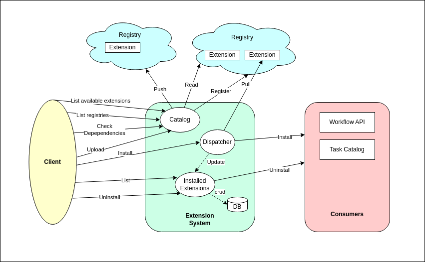
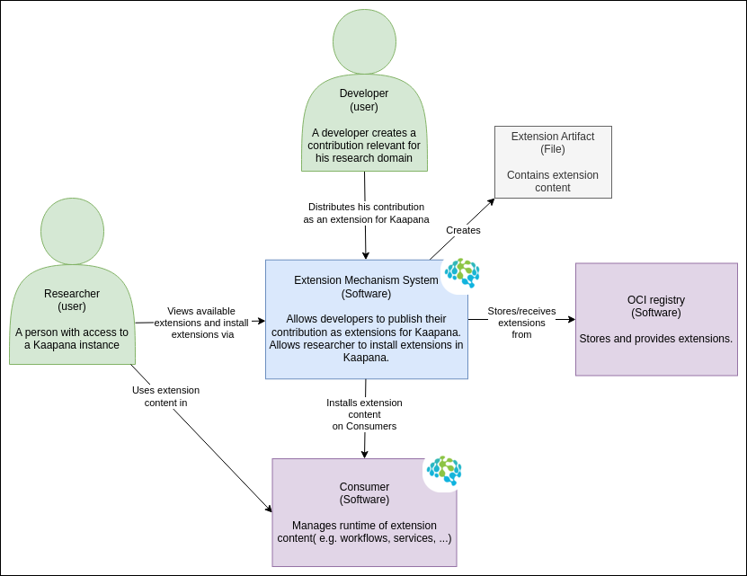
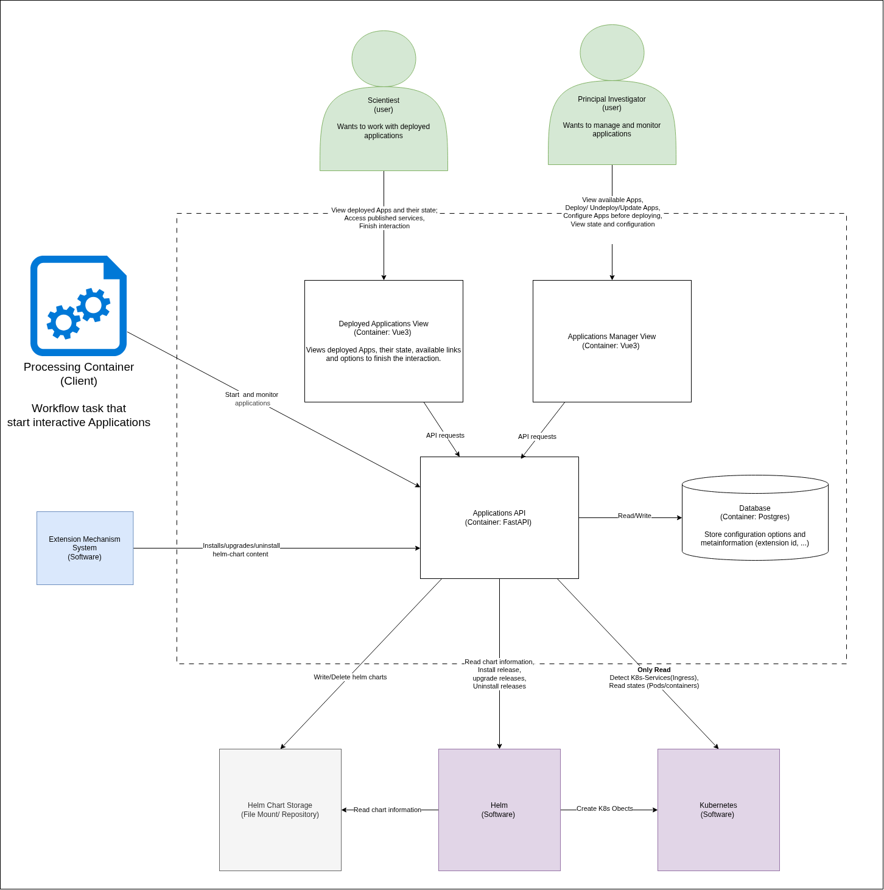

# Concept for Helm Chart Consumer

## Extension Mechanism Overview
This image shows how the Helm Chart Consumer is embedded in the system architecture and how it interacts with the Extension Manager.



### System context diagram



## Extension source code with content helm-chart
```bash
|- extension_manifest.json    ### declares the helm-chart content and its contentType helm-chart-v1 (proposed)
|_ helm-chart-content/
   |- helm-chart-content.json ### corresponds to workflow.json; Kaapana facing information (e.g. multiinstallable, UI parameter)
   |_ chart/                  ### contains only helm specific files
```


## Container diagram for helm-chart consumer




## API requirements
A proposal for the routes and models that cover these requirements is in [api-mock/](api-mock/).

### Given by the extension system
The Extension Manager dispatches every content of type helm-chart to the Helm Chart Consumer (Epic 1).
- install extension content of type helm-chart, i.e. register it (Story 1.1). Returns success or an error message, and the location of the registered content. Registering is per version. Several versions of the same helm-chart content can be registered at the same time (Q3).
- uninstall extension content of type helm-chart, i.e. deregister one version of it (Story 1.2)
- [optional]: update extension content of type helm-chart (Story 1.3)

### Given by the frontend and by workflows (to be extended)
- list the applications that can be deployed in a project, with their registered versions (Stories 2.1, 5.2, 11.1)
- enable and disable applications per project (Story 5.2)
- deploy, update and undeploy an application, each preceded by a dry-run (Stories 2.1, 2.3, 11.2–11.4)
- list deployed applications with state, details and configuration (Stories 2.4, 3.1, 3.2, 3.4)
- deploy an application from a workflow task and mark it as finished (Epic 7)
- tell the project management whether a project still has deployed applications, so that its deletion can be refused (Story 12.2)


## User groups
* user: vague user group. The role (one of the below) is implied by the context of the user story / epic.
* scientist: Can use applications in a project.
* principal-investigator (PI): Can deploy and manage applications in a project.
* kaapana-system-admin: Has admin access to all resources in Kaapana.
* platform-operator: Operates a Kaapana instance. Has access to all parts of the platform and the deployment environment.
* extension-developer: Develops extensions and their contents, e.g. helm-chart contents or workflows (including workflows that deploy applications, Epic 7).

## Priorities
Priorities define in what stage of the development process the given user story / epic should be implemented.
* MVP - Defines all user stories that a minimal viable product MUST support.
* Release 2 - Defines user stories that will be supported by the second release.
* Later - Defines user stories that will only be supported at a later stage or if the user story is requested by a customer.

A user story has the priority of its epic unless it states its own. Priorities marked *(proposed)* are suggestions that still have to be confirmed. Statements in acceptance criteria that are marked *(proposed)* fill in details that the answers in [QandA.md](QandA.md) leave open. They also still have to be confirmed.

## Epics

### Epic 1: Registering helm-chart contents through the Extension Manager
As a kaapana-system-admin I want the helm-chart content of an extension to be registered, updated and removed together with the extension, so that exactly the applications of the installed extensions can be deployed.

Priority: MVP *(proposed)*

Context:
An extension can contain a helm-chart content. When the extension is installed, its helm-chart content is registered at the Helm Chart Consumer. The version of the helm-chart content is the version of the extension. Several versions of the same helm-chart content can be registered at the same time, so that two extensions that bring different versions of it can both be installed (Q3). When the extension is uninstalled, only the helm-chart content of that version is deregistered. A deployed application is an instance of a helm-chart content that was deployed with the Helm Chart Consumer. A helm-chart content can be deregistered while its deployed applications keep running.

#### Story 1.1: Registering a helm-chart content when its extension is installed
As a kaapana-system-admin I want to install an extension that contains a helm-chart content, so that its application can be deployed.

Acceptance criteria:
* The Extension Manager dispatches the helm-chart content to the Helm Chart Consumer.
* The Helm Chart Consumer validates `helm-chart-content.json` against its schema (Story 4.2) and the chart with `helm lint`.
* Invalid content fails the installation with an understandable reason; the Extension Manager shows the content as `INSTALLATION_FAILED` together with this reason.
* Valid content is registered with name and version, and the Helm Chart Consumer returns its location to the Extension Manager.
* Retrying the installation of an already registered content version does not create a duplicate.
* Registering a new version of a helm-chart content keeps its other registered versions.
* A registered helm-chart content is offered as an application that can be deployed in the projects where it is enabled (Story 5.2). A newly registered application is disabled in all projects (Q8).

#### Story 1.2: Deregistering a helm-chart content when its extension is uninstalled
As a kaapana-system-admin I want that the helm-chart content of an uninstalled extension can no longer be deployed, so that only applications of installed extensions are offered.

Acceptance criteria:
* Uninstalling the extension deregisters the helm-chart content of that version; it is no longer offered for deployment. Other registered versions of the same helm-chart content stay deployable.
* Deployed applications of this version are not affected. They keep running and can still be opened, monitored, reconfigured (Story 11.3, Q4) and undeployed. They can be updated to another registered version (Story 11.2).
* Deployed applications whose version is no longer registered are marked as such.
* Before uninstalling, the kaapana-system-admin sees which deployed applications use this version of the helm-chart content.

#### Story 1.3: Replacing a helm-chart content version when its extension is updated
As a kaapana-system-admin I want that updating an extension replaces the registered version of its helm-chart content, so that the new version is offered for deployment instead of the old one.

Priority: Release 2 *(proposed; update is optional in the API requirements)*

Acceptance criteria:
* When an extension with a helm-chart content is updated, the helm-chart content of the old version is deregistered and the one of the new version is registered.
* Other registered versions of the same helm-chart content are not affected (Q3). Installing a new version next to the old one, instead of updating, keeps both registered (Story 1.1).
* Deployed applications on the old version keep running and are marked that a newer version is registered (updating them: Epic 11).


### Epic 2: Applications with a web interface in a project
As a scientist I want to work with an application that has a web interface (e.g. JupyterLab as a coding environment, or a segmentation viewer) on the data that I have access to in a project, so that I can analyze this data. A principal-investigator provides these applications for the project.

Priority: MVP *(proposed)*

#### Story 2.1: Deploying an application
As a principal-investigator I want to deploy an application (e.g. a JupyterLab) for my whole project or for one of its scientists, so that they can start working.

Acceptance criteria:
* A PI can browse all applications that they can deploy in their project, with name, description and registered versions. These are the applications that are enabled in the project (Story 5.2) and that support the project scope (Story 4.2).
* A PI can deploy an application in their project and chooses one of its registered versions. The newest registered version is preselected *(proposed)*. The deployed application belongs to this project.
* When deploying, the PI chooses whether the application is deployed for the whole project or for one scientist of the project (Q1). This choice is shown with the deployed application (Story 8.3). It does not restrict access. Every member of the project can open it (Story 5.3).
* Scientists cannot deploy (Q2). Besides the PI, only a kaapana-system-admin deploys in a project (Story 5.1). Whether a workflow task may deploy when a scientist started its run is open (Q15).
* Before the helm release is created, the Helm Chart Consumer runs a dry-run installation; if it fails, nothing is deployed and the PI sees the error.

#### Story 2.2: Configuring an application at deploy
As a principal-investigator I want to set parameters when I deploy an application (e.g. a display name, which folder of the project bucket to sync, whether it needs a GPU), so that the instance fits the task.

Acceptance criteria:
* A helm-chart content declares deploy parameters (name, type, default, description, required) in `helm-chart-content.json`.
* Supported parameter types cover at least string, integer, boolean and single choice from a list.
* The frontend renders a deploy form from these declarations, prefilled with the defaults.
* Parameter values are validated against their declaration (type, allowed values, optional regex) before deploying; invalid values are rejected with a message that names the parameter. Errors in the resulting chart are caught by the dry-run (Story 2.1).
* Parameter values are mapped onto chart values as declared in `helm-chart-content.json`.
* Chart values that are not declared as deploy parameters cannot be set by the user.

#### Story 2.3: Undeploying an application
As a principal-investigator I want to undeploy an application that is no longer needed, so that it no longer uses resources.

Acceptance criteria:
* A PI can undeploy every deployed application of their project.
* Undeploying removes the helm release and all Kubernetes resources it created.
* Undeploying deletes the persistent volumes of the application and the data on them (Q5). The same holds when a kaapana-system-admin or a workflow undeploys an application (Stories 3.4, 7.2, 7.4) *(proposed)*.
* Before undeploying, the PI is warned that the persistent volumes are deleted and that data which was not saved to the project storage (Story 2.6) is lost.
* An undeployed application no longer appears in the list of deployed applications.

#### Story 2.4: Opening an application
As a scientist I want to open the web interface of a deployed application, so that I can start working.

Acceptance criteria:
* A scientist can browse the deployed applications of their current project (Story 5.3).
* A deployed application with a web interface can be opened from this list as soon as its state is READY (Story 3.1).
* The web interface works as if it were accessed directly, including features that need websockets (e.g. JupyterLab kernels).

#### Story 2.5: Working on existing data
As a scientist I want to access and work on the data of my project from within an application (e.g. loading segmentations into a segmentation viewer), so that I do not have to copy data manually.

Acceptance criteria:
* An application can read the data of its project from the storage options of the platform (e.g. Data API, project bucket in MinIO).
* An application cannot read data of other projects.
* The platform provides the access (e.g. credentials, mounts); the mechanism is documented for extension-developers (Story 4.5).

#### Story 2.6: Saving results
As a scientist I want to use the results I generated in an application in a workflow of my project.

Acceptance criteria:
* An application can write results to the storage options of the platform (e.g. Data API, project bucket in MinIO).
* Results written there can be selected as input of a workflow in the same project.
* An application cannot write to the storage of other projects.

#### Story 2.7: Continuing previous work
As a scientist I want to continue working in my application where I left off last time (e.g. continue writing code in JupyterLab), so that I do not lose my work between sessions.

Acceptance criteria:
* A helm-chart content can request persistent storage for the state of its application (e.g. the JupyterLab home directory).
* This state survives restarts of the application's pods, restarts and upgrades of the platform (Story 12.1) and updates of the application (Epic 11). It is deleted when the application is undeployed (Story 2.3).
* The scientist finds their application again by its name or because it was deployed for them (Story 8.3).


### Epic 3: Monitoring deployed applications
As a scientist I want to monitor the state of a deployed application, so that I know whether I can work with it.

Priority: MVP *(proposed)*

#### Story 3.1: Seeing the status of a deployed application
As a scientist I want to see whether my deployed application is starting, ready or broken, so that I know whether I can open it or need help.

Acceptance criteria:
* Each deployed application shows one of the states DEPLOYING, READY, FAILED, UPDATING or UNDEPLOYING.
* The state is derived from the helm release and from the readiness of every Kubernetes object that the release created, e.g. available replicas, a completed Job or a bound volume claim, so that an application without long-running pods can be READY too *(proposed)*.
* Details show the underlying pods (status, restarts, age).
* A failed deployment shows an understandable reason and the error details (e.g. helm error, Kubernetes events).

#### Story 3.2: Seeing the configuration of a deployed application
As a scientist I want to see the configuration a deployed application runs with, so that I know e.g. which data folder or which resources it uses.

Acceptance criteria:
* A view shows the version and the deploy parameter values (Story 2.2) of each deployed application.
* Secret values (e.g. passwords, tokens) are masked.

#### Story 3.4: Overview of all deployed applications
As a kaapana-system-admin I want to see the deployed applications of all projects, so that I can support users and remove applications that are no longer needed.

Priority: Release 2 *(proposed)*

Acceptance criteria:
* A list shows all deployed applications with project (or platform-wide), application, version, state, deployed for, deployed by and deployed at.
* The list can be filtered by project and by state.
* A kaapana-system-admin can undeploy every deployed application.


### Epic 4: Developing helm-chart contents
As an extension-developer I want to package my application as a helm-chart content in a Kaapana extension, such that every Kaapana deployment can use it.

Priority: MVP *(proposed)*

#### Story 4.1: Packaging a helm chart as an extension
As an extension-developer I want to build an extension that contains my helm chart as a helm-chart content, so that it can be installed with the Extension Manager.

Acceptance criteria:
* The directory layout of a helm-chart content (section "Extension source code with content helm-chart") and its entry in `extension_manifest.json` are documented.
* The extension build tooling packages an extension with a helm-chart content into an OCI artifact that the Extension Manager can install.

#### Story 4.2: Declaring how Kaapana presents and deploys an application
As an extension-developer I want a documented format for `helm-chart-content.json`, so that I know which Kaapana facing information I have to provide.

Acceptance criteria:
* `helm-chart-content.json` is described by a JSON schema. It covers at least name, description, the supported scopes (project, platform-wide or both, Q11), whether the content is multi-deployable, the deploy parameters (Story 2.2) and the entry point of the web interface (Story 4.4).
* If `helm-chart-content.json` declares no scope, the content supports the project scope only *(proposed)*.
* The schema is documented with an example.
* The Helm Chart Consumer validates against this schema when it registers a content (Story 1.1).

#### Story 4.3: Avoiding conflicts with existing Kubernetes resources
As an extension-developer I want to know how I ensure that the Kubernetes objects of my helm chart do not collide with existing resources in the cluster (e.g. due to a uniqueness constraint of an object name), including other instances of my own application, so that my application can be deployed next to everything else and multiple times (Epic 8).

Acceptance criteria:
* A concept defines how conflicts are avoided (e.g. one namespace per project or per deployed application, naming prefixes/suffixes that are filled via values.yaml), see Q6.
* The Helm Chart Consumer passes the values this concept requires (e.g. a unique release name) to the chart on every deploy.
* Documentation describes the rules a helm-chart content has to follow, in particular to be multi-deployable.
* A conflict with an existing resource is detected by the dry-run (Story 2.1) and reported before anything is deployed.

#### Story 4.4: Exposing the web interface of an application
As an extension-developer I want to declare how the web interface of my application is reached, so that Kaapana can link to it and protect it.

Acceptance criteria:
* `helm-chart-content.json` declares the entry point of the web interface (e.g. service and port).
* The URL path under which the deployed application is served is passed to the chart, so that the application can serve under this path (e.g. JupyterLab `base_url`).
* The web interface is only reachable through Kaapana's authentication (Story 5.3).

#### Story 4.5: Authenticated access to Kaapana APIs
As an extension-developer I want to give my application authenticated access to Kaapana APIs, such that it can e.g. trigger workflows, communicate with the Data API or read metrics from Prometheus.

Acceptance criteria:
* The way an application obtains credentials for Kaapana APIs and storage (e.g. Data API, Workflow API, MinIO) is documented.
* The platform provides the credentials when the application is deployed; the application never handles user passwords.
* An application deployed in a project acts on behalf of this project, with the same permissions as a scientist of the project (Q7). This holds no matter who deployed or opened it. The credentials are issued to a technical user of the project or to a dedicated client of the project.
* The credentials only grant access to the project of the deployed application (platform-wide applications: Story 9.3, Q13).
* The credentials become invalid when the application is undeployed.


### Epic 5: Permission and access control
As a kaapana-system-admin I want every action that can be performed via the Helm Chart Consumer or the Extension Manager to be authorized, so that users can only do what their role permits.

Priority: MVP *(proposed)*

#### Story 5.1: Default permissions
As a kaapana-system-admin I want a default mapping of the user groups to the actions of the Helm Chart Consumer, so that access is controlled from the first installation on.

Acceptance criteria:
* kaapana-system-admin: install and uninstall extensions, enable applications for projects, deploy, update and undeploy platform-wide applications, and every action of a PI in every project.
* principal-investigator: deploy, configure, update and undeploy applications in their project, and every action of a scientist in this project. A PI cannot deploy platform-wide (Q11).
* scientist: browse and open the deployed applications of their project and the platform-wide applications, see status and configuration, and finish interactive steps (Story 7.2). A scientist cannot deploy applications (Q2), and cannot update or undeploy them either. Finishing an interactive step still undeploys its application (Story 7.2).
* The API rejects requests without the required permission; hiding actions in the frontend is not sufficient.

#### Story 5.2: Enabling applications for a project
As a kaapana-system-admin I want to enable and disable applications for projects, such that some applications can only be used in some projects.

Acceptance criteria:
* Applications can be enabled and disabled per project.
* Applications can only be deployed in projects where they are enabled.
* Disabling an application does not affect its already deployed instances (consistent with Story 1.2).
* A newly registered application is disabled in all projects until a kaapana-system-admin enables it (Q8).
* Enabling applies to the application with all its registered versions, so a newly registered version is deployable wherever the application is enabled. Whether a new version should start disabled instead is open (Q12).
* Enabling only controls deploying in a project. Deploying platform-wide (Epic 9) does not depend on it *(proposed)*.

#### Story 5.3: Restricting who can open an application
As a principal-investigator I want only members of my project to open the applications deployed in it, so that project data stays inside the project.

Acceptance criteria:
* The web interface of a deployed application is only reachable for authenticated members of its project, also when its URL is called directly.
* Every member of the project can open every deployed application of the project, also one that was deployed for another scientist (Q1).
* Browsing deployed applications only shows those of the current project.

#### Story 5.4: Custom access control model
As a platform-operator I want to create a custom access control model that fits the requirements of my project (e.g. Raccoon).

Priority: Later *(proposed; customer specific)*

Acceptance criteria:
* Custom roles can be created.
* Roles can be mapped to the actions of the Helm Chart Consumer and the Extension Manager.
* Kaapana users can be assigned to a role.

#### Story 5.5: Restricting deploy parameters per role
As a kaapana-system-admin I want to configure which deploy parameters are accessible to which role in the access control model (e.g. principal-investigator).

Priority: Later

Acceptance criteria:
* When deploying or updating an application, a deploy parameter is only configurable if the user's role permits it.
* Deploy parameters the user cannot configure keep their default value at deploy and their current value at update.

Context:
Scientists cannot deploy applications (Q2). It may still not be safe to let a PI set deploy parameters like storage mounts or network rules, while it is safe to let them configure whether the application requires a GPU. A custom access control model (Story 5.4) may also allow other roles to deploy.

#### Story 5.6: Audit log
As a kaapana-system-admin I want to see who deployed, updated or undeployed which application and when, so that I can trace changes.

Priority: Later *(proposed)*

Acceptance criteria:
* Deploy, update and undeploy actions are recorded with user, time, project, application and version.
* kaapana-system-admins can view these records.


### Epic 6: Resource governance
As a kaapana-system-admin I want to control which resources deployed applications consume in the cluster, so that a single project or helm-chart content cannot impair the platform or other projects.

Priority: Release 2 *(proposed)*

#### Story 6.1: Resource limits per project
As a kaapana-system-admin I want to limit the CPU, memory, GPU and storage that the deployed applications of a project can use, so that resources are shared fairly between projects.

Acceptance criteria:
* Limits can be configured per project.
* A deploy or update that would exceed the limits is rejected with an understandable message.
* The current usage of a project is visible to its PI and to kaapana-system-admins.


### Epic 7: Interactive steps in workflows
As a scientist I want a workflow to pause at a step where I work in an application (e.g. correcting segmentations in MITK) and continue with my results afterwards.

Priority: Release 2

#### Story 7.1: Deploying an application from a workflow
As an extension-developer I want a task of my workflow to deploy an application with the data of the current workflow run, so that the user works on exactly this data.

Acceptance criteria:
* A workflow task can deploy an application of a registered helm-chart content through the API of the Helm Chart Consumer, in the project of the workflow run.
* The input data of the task (e.g. the output of the previous task) is available in the application.
* The deployed application is marked with the workflow run and the task that deployed it.
* The task waits until the interactive step is finished (Story 7.2) or abandoned (Story 7.4).

#### Story 7.2: Finishing an interactive step
As a scientist I want to signal that I am done in the application, so that the workflow continues with my results and the application is cleaned up.

Acceptance criteria:
* The user can mark a workflow-deployed application as finished.
* Results the user saved in the application are the output of the task and available to the following tasks.
* Finishing undeploys the application.
* The waiting workflow task detects this and continues.

#### Story 7.3: Seeing pending interactive steps
As a scientist I want to see which interactive steps of my project are waiting for me, so that workflows do not stall unnoticed.

Acceptance criteria:
* The user sees how many workflow-deployed applications in their project are waiting for input.
* A list shows them with workflow run, task and waiting time, and they can be opened from there (Story 2.4).

#### Story 7.4: Cleaning up abandoned interactive steps
As a kaapana-system-admin I want applications deployed by workflows to be removed when the workflow fails or times out, so that they do not consume resources forever.

Acceptance criteria:
* A workflow-deployed application is undeployed when its task fails, is retried or times out, or when its workflow run is aborted.
* The timeout can be configured per task.


### Epic 8: Multi-deployable applications in projects
As a principal-investigator I want to deploy multiple instances of an application (e.g. JupyterLab) in my project, such that each scientist can use one instance independently.

Priority: MVP *(proposed)*

#### Story 8.1: Deploying an application multiple times
As a principal-investigator I want to deploy the same multi-deployable application several times in my project, so that several scientists can work in parallel.

Acceptance criteria:
* Only helm-chart contents declared as multi-deployable in `helm-chart-content.json` can be deployed more than once in the same project; a second deploy of any other content is rejected with an understandable message. This limit counts all versions of the application *(proposed)*.
* Multiple instances can be deployed without conflicts (e.g. in release names, Kubernetes object names, storage), see Story 4.3.
* The web interface of each instance has its own URL.
* Updating or undeploying one instance does not affect the other instances.

#### Story 8.2: Use case description for deployed applications
As a principal-investigator I want to write a use case description when I deploy an application, in order to not forget why the application was deployed.

Acceptance criteria:
* When an application is deployed it can be given a use case description.
* The description is shown in the list and in the details of deployed applications.

#### Story 8.3: Identifying deployed applications
As a scientist I want to know which applications I worked with in my last session, such that I can continue to work where I left off.

Acceptance criteria:
* Deployed applications have a human readable name that is unique within their project and shown in the user interface.
* The list of deployed applications shows name, application, version, use case description, deployed for (Story 2.1), deployed by and deployed at.
* A scientist can filter the list to the applications that were deployed for them *(proposed)*.


### Epic 9: Platform-wide applications
As a kaapana-system-admin I want to deploy applications only once for the whole platform (e.g. Collabora, OHIF, SLIM, ...), so that they are accessible from different projects and by different users. Users can access shared or project specific data through these applications.

Priority: Release 2 *(proposed)*

#### Story 9.1: Deploying an application platform-wide
As a kaapana-system-admin I want to deploy an application for the whole platform, so that not every project has to deploy its own instance.

Acceptance criteria:
* Only helm-chart contents that declare the platform-wide scope in `helm-chart-content.json` can be deployed platform-wide.
* If a helm-chart content supports both scopes, the kaapana-system-admin chooses the scope at deploy. A PI always deploys in their project (Q11).
* Only kaapana-system-admins can deploy, update and undeploy platform-wide applications.

#### Story 9.2: Using a platform-wide application
As a scientist I want to see and open the platform-wide applications, so that I can use them for my work in a project.

Acceptance criteria:
* All permitted users (Story 5.1) can view the available platform-wide applications.
* All permitted users can open the available platform-wide applications.

#### Story 9.3: Project data in platform-wide applications
As a scientist I want a platform-wide application (e.g. OHIF) to show the data of the project I am currently working in, so that project data stays inside the project.

Acceptance criteria:
* A platform-wide application is opened in the context of the current project.
* It only shows data of this project and data that is shared with all projects.


### Epic 10: Platform-wide multi-deployable applications
As a kaapana-system-admin I want to deploy multiple instances of an application for the whole platform, such that different deployment configurations of the same application can exist simultaneously.

Priority: Later

User stories are defined once the epic is prioritized.


### Epic 11: Updating deployed applications
As a user I want to update a deployed application, because I want to change its configuration or upgrade to a new version of its helm-chart content.

Priority: Release 2 *(proposed)*

Context:
The user is a kaapana-system-admin for platform-wide applications and a principal-investigator for applications deployed in a project.

#### Story 11.1: Browsing available versions
As a user I want to see which versions of an application are available, so that I can decide whether to update.

Acceptance criteria:
* A helm-chart content has a version; it is the version of the extension that contains it.
* All registered versions of an application are listed, i.e. only versions of installed extensions. Several versions can be registered at the same time (Q3).
* Each deployed application shows its version and whether a newer version is registered.

#### Story 11.2: Updating a deployed application to a new version
As a user I want to update an application to a new version, such that I get the benefits of the new version.

Acceptance criteria:
* The API supports updating a deployed application to another registered version.
* A dry-run is executed before the update; if it fails, the deployed application is not changed.
* Persistent data of the application is kept.
* Kubernetes resources that the new version no longer defines are removed.
* During the update the state of the deployed application is UPDATING (Story 3.1).
* A failed update sets the state FAILED with an understandable reason.

#### Story 11.3: Updating deploy parameters
As a user I want to update the deploy parameters of a deployed application, such that I can change volume size, resources and other available deploy parameters.

Acceptance criteria:
* The API supports updating the deploy parameters of a deployed application without changing its version.
* This also works when the version of the deployed application is no longer registered (Story 1.2, Q4). To make this possible, the Helm Chart Consumer keeps the chart and the deploy parameter declarations of every deployed application after its version is deregistered.
* The update form is prefilled with the current values, so that unchanged parameters keep their values.
* Each parameter can be reset to the default of the helm-chart content.
* The values are validated as at deploy (Story 2.2).
* Persistent data of the application is kept.

#### Story 11.4: Setting deploy parameters when updating the version
As a user I want to set the deploy parameters when I update an application to a new version, because a new version can introduce new parameters.

Acceptance criteria:
* The deploy parameters can be changed in the same step as the version.
* The form shows the parameters of the new version: parameters that exist in both versions are prefilled with their current values, new parameters with their defaults.
* Values of parameters that the new version no longer declares are dropped.

Context:
The new version of an application could introduce new parameters that should be configurable in the update, or change the behaviour of existing parameters.

#### Story 11.5: Rolling back a failed update
As a user I want to roll back an application to its previous version and deploy parameters when an update fails, so that I can continue working.

Priority: Later *(proposed)*

Acceptance criteria:
* A deployed application in state FAILED after an update can be rolled back to its last working version and deploy parameters.
* Persistent data of the application is kept.


### Epic 12: Operating the Helm Chart Consumer
As a platform-operator I want deployed applications to stay consistent with the rest of the platform over time, so that users do not lose applications or data and no orphaned resources remain.

Priority: MVP *(proposed)*

#### Story 12.1: Surviving restarts and platform upgrades
As a platform-operator I want registered helm-chart contents and deployed applications to survive a restart or an upgrade of the Helm Chart Consumer and of the platform, so that users can continue working afterwards.

Acceptance criteria:
* After a restart or an upgrade, all registered helm-chart contents and deployed applications are listed with their correct state.
* The records of the Helm Chart Consumer are reconciled with the helm releases in the cluster; releases that were changed or removed outside of the Helm Chart Consumer are detected and shown.

#### Story 12.2: Deleting a project with deployed applications
As a kaapana-system-admin I want that a project with deployed applications cannot be deleted, so that deleting a project never leaves running applications or reachable project data behind.

Acceptance criteria:
* Deleting a project is refused while it has deployed applications (Q9). This includes workflow-deployed applications *(proposed)*.
* The refusal names the deployed applications that have to be undeployed first *(proposed)*.


## Out of scope
* Making the container images of a chart available in air-gapped Kaapana installations is not a task of the Helm Chart Consumer (Q10).


## Open questions
The answers to Q1 to Q11, except Q6, are recorded in [QandA.md](QandA.md) and are worked into the stories and the out-of-scope section above. The stories cite them as (Qn).

* Q6 Namespaces: Do deployed applications run in one namespace per project, one per deployed application, or a shared namespace? This affects Stories 4.3, 5.3 and 6.1. The answer is needed at a later stage.
* Q12 Enabling new versions: Story 5.2 enables an application with all its registered versions, so a new version is deployable at once wherever the application is enabled. Should a new version instead start disabled, like a new application (Q8)?
* Q13 Identity of platform-wide applications: An application in a project acts on behalf of its project (Q7). On whose behalf does a platform-wide application act when it is opened in the context of a project (Story 9.3)?
* Q14 Identity of a helm-chart content: Several extensions can bring versions of the same helm-chart content (Q3). What identifies a helm-chart content, its name alone or the extension name together with the content name? What happens when two different extensions register the same name and version (Story 1.1)?
* Q15 Deploying from workflows: A workflow task deploys an application in the project of its run (Story 7.1). May it do so when a scientist started the run, although scientists cannot deploy (Q2)?


## Glossary

* Extension: An OCI artifact that is installed with the Extension Manager. It contains one or more contents, e.g. a workflow or a helm-chart content.
* Helm-chart content: The content type of an extension that is managed by the Helm Chart Consumer. It consists of `helm-chart-content.json` and a helm chart.
* Helm Chart Consumer: The system component that registers the helm-chart contents of extensions and deploys, updates and undeploys applications.
* Application: The user facing name of a registered helm-chart content, i.e. something that can be deployed (e.g. JupyterLab).
* Deployed application: An instance of an application, i.e. a helm release that the Helm Chart Consumer created from a helm-chart content, either in a project or platform-wide. The API calls it a release.
* Register / deregister: Make a helm-chart content deployable / no longer deployable at the Helm Chart Consumer. Triggered by installing / uninstalling its extension.
* Deploy / undeploy: Create / remove a deployed application. "Install" and "uninstall" are only used for extensions.
* Deploy parameter: A value declared in `helm-chart-content.json` that a user sets when deploying or updating an application. It is mapped onto a chart value.
* Project-scoped / platform-wide: A deployed application belongs either to one project or to the whole platform. A helm-chart content declares which of the two scopes it supports, or both.
* Deployed for: A deployed application in a project is deployed either for the whole project or for one scientist of it. This does not restrict access, because every member of the project can open it.
* Multi-deployable: A helm-chart content that can be deployed several times in the same scope, i.e. several times in one project or several times platform-wide. Declared in `helm-chart-content.json` (e.g. as `multiinstallable`).
* Interactive step: A workflow task that deploys an application and waits until a user finishes working in it (Epic 7).
* Workflow-deployed application: A deployed application that was deployed by an interactive step.
